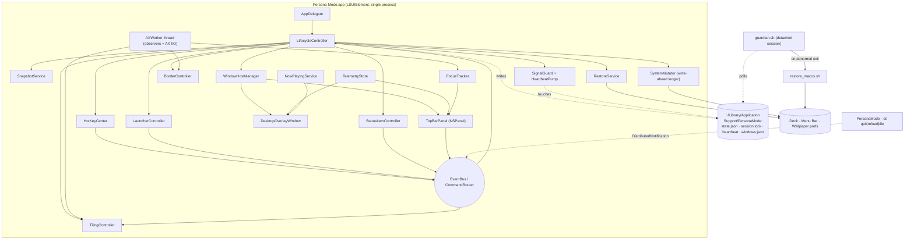
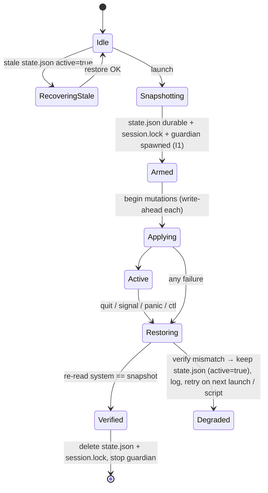

# Persona Mode — Architecture

> A standalone, toggleable macOS "rice" inspired by Persona 3 Reload.
> **Launch = themed desktop. Quit (any way, including crash/kill) = stock macOS.**
> No SIP changes, no system-file edits, no private entitlements, no LaunchAgents.

Status: **design frozen for implementation.** The companion checklist is [`TODO.md`](./TODO.md).

---

## 0. Table of Contents

1. [Goals, Non-Goals, Invariants](#1-goals-non-goals-invariants)
2. [Environment Findings (probed on the dev machine)](#2-environment-findings-probed-on-the-dev-machine)
3. [Architecture Decision Records](#3-architecture-decision-records)
4. [System Overview & Threading](#4-system-overview--threading)
5. [Window Levels, Collection Behaviors, Click-Through](#5-window-levels-collection-behaviors-click-through)
6. [Permissions Matrix](#6-permissions-matrix)
7. [IPC & Event Flow](#7-ipc--event-flow)
8. [Subsystem Specs](#8-subsystem-specs)
9. [State Restoration & Fail-Safe Recovery](#9-state-restoration--fail-safe-recovery-critical)
10. [Directory Structure](#10-directory-structure)
11. [Build, Sign, Run, Test Workflow](#11-build-sign-run-test-workflow)
12. [Configuration & Hotkeys](#12-configuration--hotkeys)
13. [Risk Register & Spikes](#13-risk-register--spikes)
14. [Performance Budgets](#14-performance-budgets)
15. [Assets & Legal](#15-assets--legal)

---

## 1. Goals, Non-Goals, Invariants

### Goals
| # | Goal |
|---|------|
| G1 | Launching the app applies: top bar, desktop HUD, glowing active-window border, auto-tiling with gaps, floating launcher, themed terminal/fastfetch profiles. |
| G2 | Quitting the app by **any** path returns macOS to its prior state with no residue other than TCC permission grants (see §9.9). |
| G3 | The user can never be left with a hidden Dock/Menu Bar, even after `kill -9`. |
| G4 | Runs on stock macOS with SIP **enabled**; only public APIs on the write path (a few read-only private symbols are allowed, each with a public fallback). |

### Non-Goals (v1)
- Animated window motion (Hyprland-style). AX frame setting is instant; interpolation is a v2 stretch.
- Virtual workspaces that hide windows (see ADR-5 — crash-unsafe).
- Controlling real macOS Spaces without the user enabling the "Switch to Desktop N" shortcuts.
- Now-Playing from browsers (MediaRemote is closed to third parties since macOS 15.4 — ADR-7).

### Invariants (every PR/phase must preserve these)
| ID | Invariant |
|----|-----------|
| **I1** | **Snapshot before mutate.** No system mutation happens until `state.json` (with the pristine snapshot) is durably on disk (`fsync` + atomic rename). |
| **I2** | **Never snapshot a modified system.** If a stale `state.json` with `active:true` exists at launch, run restore *first*, then take a fresh snapshot. |
| **I3** | **Write-ahead ledger.** Each mutation is recorded as `pending` *before* it is performed, then marked `applied`. Restore treats `pending` and `applied` identically. |
| **I4** | **Restore is idempotent and absolute.** It *sets original values*; it never toggles or inverts. Running it N times is the same as once. |
| **I5** | **Critical-first restore order.** Dock → Menu Bar → Wallpaper are restored before any visual teardown or window-frame work (which can hang on unresponsive apps). |
| **I6** | **Fail-open.** If any module fails to start (e.g. Accessibility denied) the app degrades (bar/HUD only) — it never retries a system mutation in a loop. |
| **I7** | **Every mutation has an owner and an inverse** registered in the `Mutator` table (§9.4). A mutation without a registered inverse must not compile into the build (enforced by an enum + exhaustive switch). |
| **I8** | **No ambient persistence.** No `UserDefaults`, no LaunchAgent, no login item, no files outside the *Trace Budget* (§9.9). |

---

## 2. Environment Findings (probed on the dev machine)

These were measured on 2026-10-26 and drive several decisions. Re-verify with `scripts/doctor.sh` (Phase 1).

| Finding | Value | Consequence |
|---------|-------|-------------|
| macOS | **26.6.2 (Tahoe)**, arm64 | Target `macOS 14+`, develop/validate on 26. Re-validate window-level behavior on Tahoe (Spike S-2). |
| Display | Built-in Liquid Retina 2560×1664 → **notched MacBook** | Top bar must be notch-aware (`safeAreaInsets`, `auxiliaryTopLeftArea/RightArea`). |
| Toolchain | Swift 6.4, **Command Line Tools only (no Xcode.app)** | Use **SwiftPM**, assemble the `.app` with a script. No `xcodebuild`, no asset catalogs/`actool`, no storyboards. |
| Test frameworks | `swift test` **does not work**: XCTest absent; Swift Testing's macro plugin is not auto-loaded (`plugins/testing/libTestingMacros.dylib` exists but `-plugin-path` workaround still fails at `codesign` of `.xctest`) | Use a **self-test executable** (`persona-selftest`) + runtime `--probe` flags (ADR-9). |
| Build output | New SwiftPM backend → products under `.build/out/Products/<cfg>/` | Never hardcode; use `swift build --show-bin-path`. |
| Prefs state | `_HIHideMenuBar`, `AppleMenuBarVisibleInFullscreen`, `com.apple.dock autohide` are all **absent** (defaults apply) | Snapshot must model **`present: Bool` + `value`**, and restore must *delete* keys that were originally absent (or leave a behaviorally identical value — §9.5). |
| Terminals | **No Ghostty / kitty installed**; `fastfetch 2.67.1` present at `/opt/homebrew/bin` | Terminal.app fallback path is the one that will actually run here → must be first-class (§8.6). |
| Tiling tools | `aerospace` / `borders` **not installed** | Another reason against orchestrating them (ADR-1). |
| `plutil` | `plutil -extract a.b raw -o - file.json` works on JSON | `restore_macos.sh` can parse state with **zero dependencies** (no `jq`, no `python`). |
| Fonts | Rajdhani + Bebas Neue (OFL) reachable at `github.com/google/fonts/raw/main/ofl/…` | Bundle OFL fonts, register process-scoped (zero trace). |

---

## 3. Architecture Decision Records

### ADR-1 — Native Swift AX tiler + border renderer (NOT AeroSpace/JankyBorders)
**Decision:** Build the tiler and border renderer in-process.

| Criterion | Native Swift (chosen) | Orchestrate AeroSpace + JankyBorders |
|-----------|----------------------|---------------------------------------|
| **Crash safety (G3)** | Tiler only ever calls `AXUIElementSetAttributeValue(position/size)`. A crash leaves windows merely *positioned oddly but visible*. | **AeroSpace emulates workspaces by moving windows off-screen** (to a screen corner). A `kill -9` of AeroSpace strands windows invisible. Violates G3 directly. |
| Process lifecycle | One process (+ shell guardian). | Three daemons to spawn, health-check, and reap; orphans survive crashes unless separately guarded. |
| Dependencies | None. | Requires `brew install` of two third-party tools; **neither is installed here**; version drift breaks config formats. |
| Private API | Optional `_AXUIElementGetWindow` (stable for >10 yrs; frame-match fallback exists). | JankyBorders uses private SkyLight APIs extensively. |
| Top-bar inset | Native: our own layout math (`reservedTop`). | AeroSpace `outer.top` gap — works, but must be kept in sync with the bar height across process boundary. |
| Visual coupling | Border color/glow/pulse tied to our theme tokens and focus events directly. | Border style limited to JankyBorders options (no pulse, no custom glow). |
| Cost | We implement dwindle layout + AX observer plumbing (~1.5k LOC). | Less code, more integration risk. |
| Zero-trace | Nothing to uninstall. | Config files + processes to clean; AeroSpace may also modify Mission Control prefs advice. |

Rejected hybrid: "use AeroSpace for tiling only". Same off-screen-window hazard.

### ADR-2 — Native SwiftUI/AppKit rendering (NOT `WKWebView` HTML/CSS)
- Skewed polygons are trivial with SwiftUI `Shape`/`Path` + `Canvas`; animations via `TimelineView`.
- `WKWebView` spawns 3 helper processes *per web view* (WebContent/GPU/Networking), needs private KVC (`drawsBackground`) for transparency, complicates click-through and hit-testing, and costs more battery. Three always-on web views (bar, HUD, launcher) would exceed the memory budget (§14) and add three more processes to reap on quit.
- Layout: **AppKit owns windows; SwiftUI (`NSHostingView`) owns pixels.**

### ADR-3 — SwiftPM package + script-assembled `.app` (CLT-only machine)
- `Package.swift` with 3 targets (§10). `scripts/build_app.sh` builds release, creates `Persona Mode.app`, writes `Info.plist` (`LSUIElement=true`), copies `Resources/`, codesigns.
- **Do not use SwiftPM `resources:`**: the generated `Bundle.module` accessor looks for `<Name>_<Name>.bundle` next to the `.app` root (not `Contents/Resources`) and `fatalError`s inside a bundle. Load assets via `Bundle.main.url(forResource:)`; in unbundled dev runs fall back to `PERSONA_RESOURCE_DIR` or `<repo>/Resources`.
- Swift language mode **5** for all targets (`.swiftLanguageMode(.v5)`): AppKit/AX/CF C-API interop under Swift 6 strict concurrency adds friction with no safety payoff here. Tools-version 6.0, `platforms: [.macOS(.v14)]`.
- **TCC & signing:** Accessibility trust is keyed on code identity. Ad-hoc signing changes the cdhash every rebuild, silently invalidating the grant. `scripts/setup_signing.sh` creates a stable self-signed code-signing identity ("PersonaMode Dev"); `build_app.sh` falls back to ad-hoc with a loud warning.

### ADR-4 — Wallpaper default = in-app overlay, not mutating the system wallpaper
- `wallpaper.mode = "overlay"` (default): the themed wallpaper is rendered *procedurally* (SwiftUI `Canvas`: midnight gradient, moon, geometric accents) in the desktop overlay window at level `desktopIconWindow − 1`. **The system wallpaper is never touched ⇒ restoring it is trivially exact** and aerial/dynamic/Shuffle wallpapers (which `NSWorkspace` cannot round-trip on Sonoma+) are safe.
- `wallpaper.mode = "system"` (opt-in): calls `NSWorkspace.setDesktopImageURL(_:for:options:)`. Refused at runtime unless the snapshotted wallpaper is a plain readable image file. A forensic copy of `~/Library/Application Support/com.apple.wallpaper/Store/Index.plist` is saved to the state dir (manual last-resort, never auto-restored).
- `wallpaper.mode = "none"`: HUD only, transparent over the user's own wallpaper.
- The snapshot **always** records per-screen wallpaper regardless of mode (requirement + safety net).

### ADR-5 — Workspaces 1–5 = real macOS Spaces, read-only indicator (NOT virtual workspaces)
- Virtual workspaces require hiding windows (off-screen move / minimize / hide) ⇒ crash-unsafe or visually noisy.
- Indicator reads the Space list/active Space via read-only private `CGSCopyManagedDisplaySpaces` + `CGSGetActiveSpace` (no SIP impact, used by many tools), refreshed on public `NSWorkspace.activeSpaceDidChangeNotification`. **Fallback** if symbols are missing: single pill "1" active.
- Clicking a pill / `⌃⌥N` posts a synthetic `Ctrl+N` (CGEvent). It works only if the user enabled *Keyboard Shortcuts → Mission Control → Switch to Desktop N*; the app detects this by reading `com.apple.symbolichotkeys` (read-only) and shows a one-line hint if disabled.
- Tiling is **per active Space** (AX only exposes windows of the current Space anyway).

### ADR-6 — Top bar window level (**amended: default is now `.statusBar` (25)**; originally `.mainMenu − 1` (23))
> **Amendment (project owner request, see `docs/SPIKE_RESULTS.md` S-2):** the default is `.statusBar` with `collectionBehavior` including `.fullScreenAuxiliary`. The trade-off analysed below still applies: while the native menu bar is not auto-hidden, the bar covers it. `topBar.level = "mainMenuMinusOne"` restores the original behavior.

- The spec offers `.statusBar` or `.mainMenu + 1` (both = 25). A level above the native menu bar (24) would **permanently cover the native menu bar even when auto-hide reveals it**, making app menus (File/Edit/…) unreachable — an unrecoverable usability trap.
- Level **23** sits above all normal/floating/modal windows but *below* the revealed native menu bar, so hovering the top edge reveals native menus on top of our bar. `topBar.level` config accepts `"statusBar"` to honor the literal spec.
- Panel must override `constrainFrameRect(_:to:)` to return the requested frame (AppKit otherwise pushes panels below the menu bar / notch).

### ADR-7 — Now Playing via distributed notifications (NOT MediaRemote)
- Since macOS 15.4, `mediaremoted` refuses third-party clients; private `MediaRemote.framework` returns nothing on 26.x.
- Use `DistributedNotificationCenter` for `com.apple.Music.playerInfo` and `com.spotify.client.PlaybackStateChanged` (userInfo: `Name`, `Artist`, `Album`, `Player State`). **No permission prompt, no polling.**
- Initial state on launch: AppleScript query **only if** `NSRunningApplication` shows the player already running (AppleScript to a non-running app *launches it* — forbidden).
- Browser/other sources: out of scope for v1; widget shows "— NOTHING PLAYING —".

### ADR-8 — Shell watchdog ("guardian") + heartbeat for crash/SIGKILL/hang safety
- In-process handlers cannot catch `SIGKILL`, OOM kills, or a hung main thread. A detached `guardian.sh` (own session via `POSIX_SPAWN_SETSID`) restores state when it detects: app PID gone while `session.lock` still exists, or a stale `heartbeat` file. Details in §9.7.
- No LaunchAgent is used (I8).

### ADR-9 — Testing without XCTest: `persona-selftest` + `--probe`
- `PersonaCore` (pure logic) is exercised by an executable target `persona-selftest` with a tiny assertion harness (non-zero exit on failure).
- Platform behavior (windows, AX, telemetry) is verified by `PersonaMode --probe <name>` modes that print JSON to stdout, consumed by shell assertions using `plutil -extract`.
- Visual verification: `PersonaMode --probe render <view> <out.png>` renders SwiftUI views offscreen via `ImageRenderer` so an agent can inspect PNGs without Screen Recording permission.

### ADR-10 — Global hotkeys via Carbon `RegisterEventHotKey`
- Needs **no** Accessibility/Input-Monitoring permission, still supported on macOS 26, works in `LSUIElement` apps. (`CGEventTap` would need extra permission and can't be cleanly scoped.)
- Registration failures (key already taken) are reported in the status menu, never fatal.

### ADR-11 — JSON config (`Codable`), hot-reloadable
- No TOML/YAML dependency. Built-in defaults in code; optional override at `~/Library/Application Support/PersonaMode/config.json` (user-authored, never created by the app); repo default at `config/default-config.json`.

---

## 4. System Overview & Threading



### Threading model
| Thread | Owns | Rules |
|--------|------|-------|
| **Main (`@MainActor`)** | All AppKit/SwiftUI, `AppState`, lifecycle, `CommandRouter`, hotkey callbacks | Never block > 50 ms. Shell/AppleScript calls run with a hard timeout (`ShellRunner`, default 3 s). The *restore* path is the sole exception (synchronous, time-boxed, §9.6). |
| **`AXWorker`** (dedicated `Thread` with a running `CFRunLoop`) | `AXObserver` run-loop sources; all `AXUIElement` reads/writes; `AXUIElementSetMessagingTimeout(…, 0.25)` | A hung target app can only stall this thread, never the UI. Results are marshalled to main as value-type `WindowEvent`/`FrameCommand`. |
| **Telemetry timers** (`DispatchSourceTimer` on a utility queue) | CPU/RAM sampling | Publish value types to main. |
| **Heartbeat thread** | Touches `heartbeat` once per second *only if* main-thread "pong" is < 8 s old | Lets the guardian distinguish "dead/hung" from "busy". |

### Coordinate systems (a classic bug source)
- AppKit: origin **bottom-left of the primary display**, y up.
- AX / CG window lists: origin **top-left of the primary display**, y down.
- `PersonaCore.CoordinateSpace` provides `toAX(_ nsRect:primaryHeight:)` / `toAppKit(...)` and is covered by selftests. *All layout math is done in AX (top-left) space.*

---

## 5. Window Levels, Collection Behaviors, Click-Through

Numeric values (from `CGWindowLevel.h`) for reference — **always use the API constants, never hardcode**; Spike S-2 logs the real values at startup.

| Constant | Value | Used by |
|----------|-------|---------|
| `CGWindowLevelForKey(.desktopWindow)` | `INT32_MIN + 20` | system wallpaper (not ours) |
| `CGWindowLevelForKey(.desktopIconWindow)` | `desktopWindow + 20` | Finder desktop icons |
| **`desktopIconWindow − 1`** | | **DesktopOverlayWindow** (above wallpaper, below icons & all app windows) |
| `.normal` | 0 | app windows |
| `.floating` | 3 | **BorderOverlayWindow** (fallback; ring is drawn in the *gap*, see §8.4) |
| `.modalPanel` | 8 | |
| `.mainMenu` | 24 | native menu bar |
| **`.mainMenu − 1`** | **23** | **TopBarPanel** (ADR-6) |
| `.statusBar` | 25 | alt. bar level (literal spec) |
| **`.popUpMenu` − 1 (100)** | | **LauncherPanel** (above bar, below real pop-up menus) |
| `.popUpMenu` | 101 | system menus |

| Window | Style mask | `level` | `collectionBehavior` | `ignoresMouseEvents` | Key/Main | Notes |
|--------|-----------|---------|----------------------|----------------------|----------|-------|
| **TopBarPanel** | `[.borderless, .nonactivatingPanel]` | 23 | `[.canJoinAllSpaces, .stationary, .ignoresCycle]` (no `.fullScreenAuxiliary` ⇒ hidden over fullscreen apps) | `false` (needs clicks) | `canBecomeKey=false`, `canBecomeMain=false` | `isOpaque=false`, `backgroundColor=.clear`, `hasShadow=false`, `hidesOnDeactivate=false`, override `constrainFrameRect` |
| **DesktopOverlayWindow** | `[.borderless]` | `desktopIconWindow − 1` | `[.canJoinAllSpaces, .stationary, .ignoresCycle]` | **`true`** (click-through, mandatory) | no/no | Opaque only in `wallpaper.mode=overlay`; otherwise transparent. `sharingType=.none`, `isExcludedFromWindowsMenu=true`. |
| **BorderOverlayWindow** | `[.borderless]` | `.floating` (spike S-4 may use `order(.above, relativeTo:)`) | `[.canJoinAllSpaces, .stationary, .ignoresCycle, .transient]` | **`true`** | no/no | Full-screen-sized per display; one `CAShapeLayer`. |
| **LauncherPanel** | `[.borderless, .nonactivatingPanel]` | 100 | `[.canJoinAllSpaces, .fullScreenAuxiliary]` | `false` | **`canBecomeKey=true`** override (text field needs focus; non-activating style means the previously active app stays frontmost) | Closes on `Esc`, on `didResignKeyNotification`, after launching. |

Notch handling: if `screen.safeAreaInsets.top > 0`, bar height = `max(config.height, safeAreaInsets.top)`, and content is split into left/right clusters using `auxiliaryTopLeftArea` / `auxiliaryTopRightArea` so nothing hides under the notch.

Multi-display: one TopBarPanel + one Border window per `NSScreen`; HUD content only on the primary (configurable); desktop overlay on every screen. Rebuild on `NSApplication.didChangeScreenParametersNotification` and `NSWorkspace.didWakeNotification`.

---

## 6. Permissions Matrix

| Permission | Needed for | How requested | If denied |
|------------|-----------|---------------|-----------|
| **Accessibility** (`AXIsProcessTrustedWithOptions`) | Tiling, window title in bar, border follow, window-frame restore | On first launch: onboarding sheet + `AXIsProcessTrustedWithOptions([prompt:true])`; poll every 1 s; deep link `x-apple.systempreferences:com.apple.preference.security?Privacy_Accessibility` | Tiling/border/title disabled; bar + HUD + launcher still work (I6). Status menu shows ⚠. Enabling later hot-starts the modules without restart. |
| **Automation → System Events** | Read/set Dock & Menu Bar auto-hide (live, no `killall Dock`) | First AppleScript call triggers the OS prompt; `Info.plist` has `NSAppleEventsUsageDescription` | **Fallback:** `defaults write com.apple.dock autohide` + `killall Dock` for Dock; Menu Bar hide is skipped (bar overlaps menu bar region instead, level 23 keeps native menu reachable). Snapshot/restore remain consistent. |
| Automation → Music / Spotify | Initial Now-Playing state only | Only if the app is already running | Widget waits for the first notification. |
| Automation → Terminal.app | Fallback terminal profile cleanup | On demand | Profile remains (documented residue). |
| Screen Recording | **Never required.** Window *titles* come from AX, not `kCGWindowName`. `CGWindowListCopyWindowInfo` bounds/layer/PID need no permission. | — | — |
| Input Monitoring | **Never required** (Carbon hotkeys, ADR-10). | — | — |
| Location Services | **Never required.** Wi-Fi SSID needs it on macOS 14+, so the Wi-Fi pill shows interface/RSSI via `NWPathMonitor` + `CWInterface.rssiValue()`, not SSID. | — | — |
| Full Disk Access | Never. | — | — |

`AXIsProcessTrusted` must be evaluated against the **bundled, signed** app. Running via `swift run` attaches trust to the parent Terminal — always test AX features from `build/Persona Mode.app`.

---

## 7. IPC & Event Flow

### 7.1 In-process
- **`AppState`** (`@MainActor @Observable`): single source of truth read by SwiftUI (`focusedApp`, `focusedTitle`, `activeSpace`, `telemetry`, `nowPlaying`, `phase: DarkHourPhase`, `axTrusted`, `tilingEnabled`, `lifecycle: LifecycleState`).
- **`EventBus`**: typed `enum PersonaEvent` published via `AsyncStream`/Combine (`windowCreated`, `windowDestroyed`, `focusChanged`, `frameChangedExternally`, `spaceChanged`, `screensChanged`, `axTrustChanged`, `configChanged`, `telemetryTick`).
- **`CommandRouter`**: the only entry point for user intent. `enum PersonaCommand { tileNow, toggleFloatFocused, reloadTheme, toggleDarkHour, openTerminal, showLauncher, hideLauncher, switchSpace(Int), exitPersona, panic }`. Sources: hotkeys, launcher, status item, bar buttons, `--ctl`.

### 7.2 External control (scripts → running app)
`PersonaMode --ctl quit|reload|tile|panic` posts a `DistributedNotificationCenter` notification `dev.persona.mode.command` (`userInfo["cmd"]`) and exits immediately without starting UI. The running app maps it to `PersonaCommand`. (No sockets, no URL-scheme registration — both would leave persistent system registrations or listening daemons.)

### 7.3 Filesystem protocol with the guardian / restore script
All under `~/Library/Application Support/PersonaMode/`:

| File | Writer | Reader | Meaning |
|------|--------|--------|---------|
| `state.json` | app (atomic) | app, `restore_macos.sh`, guardian | Snapshot + write-ahead ledger + `active` flag |
| `session.lock` | app (`flock`-held, contains PID) | guardian, next launch | Exists ⇔ a session is active. Deleted **last** on successful restore. |
| `heartbeat` | app heartbeat thread | guardian | mtime = main thread liveness |
| `windows.json` | app | app | Original window frames journal (best effort) |
| `wallpaper-index.plist.bak` | app (system mode only) | human | Forensic backup |

---

## 8. Subsystem Specs

### 8.1 Top Bar (Waybar equivalent)
- Height `34` pt (config), margin top `6`, side margins `10`. Notch-aware (§5).
- **Left cluster:** workspace pills 1–5 (skewed parallelograms; active = filled cyan `#00d8ff` with dark text and outer glow; occupied = outlined; empty = dim). Then focused app name (Bebas Neue, uppercase) and window title (Rajdhani, truncated, from AX).
- **Right cluster:** pills `CPU %`, `RAM %`, `BAT %` (+ bolt when charging), `WIFI` (bars from RSSI; slashed when offline), `VOL` (speaker + %; muted state), clock/date badge (`HH:mm` big, `EEE dd MMM` small), and a **QUIT** button (angled, red-tinted on hover; tooltip "Return to macOS").
- Pill thresholds: CPU/RAM ≥ 85 % → warn color token; battery ≤ 20 % & not charging → alert color + pulse.
- All geometry in `Shapes/` (`SkewedPill`, `AngledPanel`, `ChevronBadge`) with a single `skew` token (default `-12°` shear) so the design is globally tunable.

### 8.2 Desktop HUD (Eww/Conky equivalent)
- Procedural wallpaper (`WallpaperView`): midnight gradient (`#050c1a → #0a192f`), large crescent moon, thin cyan geometric lines/hex grid, subtle noise via `Canvas`.
- **Date/Time widget** (top-right, angled panel): big `HH:mm`, weekday, date, and a phase tag from `DarkHourPhase`:
  - `DARK HOUR` 00:00–00:59 (teal-green tint token `#5dffcf`, moon glow intensifies), otherwise `EARLY MORNING` (05–10), `DAYTIME` (10–17), `EVENING` (17–22), `LATE NIGHT` (22–24, 01–05). `toggleDarkHour` command forces the theme on/off for demos.
- **Now Playing widget** (bottom-left, skewed comic-book frame, halftone dots, title/artist, play-state glyph).
- **Ambient accents:** slow rotating hex rings / drifting diagonal bars via `TimelineView(.animation(minimumInterval: 1/30))`. Paused when: `ProcessInfo.isLowPowerModeEnabled`, display asleep (`NSWorkspace.screensDidSleepNotification`), or on battery < 20 %.

### 8.3 Tiling Engine (Hyprland dwindle)
**Layout engine** — pure, in `PersonaCore/Layout/LayoutEngine.swift`:
```
func layout(ids: [WindowID], screen: CGRect /*AX coords*/, bar: BarInset, gaps: Gaps,
            algorithm: .dwindle | .masterStack, splitRatio: CGFloat) -> [WindowID: CGRect]
usable = screen.inset(top: bar.marginTop + bar.height + gaps.outer,
                      left: gaps.outer, bottom: gaps.outer, right: gaps.outer)
```
- **Dwindle:** window *i* takes `splitRatio` of the remaining rect; split axis alternates, chosen by aspect ratio (`w ≥ h ⇒ vertical split`). Inner gap `g` is subtracted at the seam: `first = (extent − g) * ratio`, `second.origin = origin + first + g`.
- **Master-stack:** master left (55 %), rest stacked right.
- Rects are rounded to integer points. **Invariants (selftested):** all rects inside `usable`; no overlaps; seam gaps == `gaps.inner`; `minY ≥ bar.marginTop + bar.height + gaps.outer`.

**Window eligibility** (`FloatRules`): tile only if role `AXWindow` & subrole `AXStandardWindow`, not minimized, not full-screen (`AXFullScreen`), `AXSize` and `AXPosition` settable, app activation policy `.regular`, size ≥ 200×120, bundle ID not in `tiling.floatApps` (default: System Settings, Calculator, Archive Utility, Persona Mode itself, Installer, Keychain Access dialogs). Sheets/dialogs/panels float automatically. User override per window: `⌃⌥F`.

**Apply protocol** (per window, on `AXWorker`): `set size → set position → set size` (the second size fixes apps that clamp during move) → read back; if the read-back frame ≠ target (min-size constraints), accept it and **do not fight** (mark `constrained`, no retry loop). Suspend `AXEnhancedUserInterface` for the target app during the batch only if it is set (Chrome/Electron animation lag), restoring it after.

**Triggers:** `kAXWindowCreated`, `kAXUIElementDestroyed`, `kAXWindowMiniaturized/Deminiaturized`, app launch/terminate (`NSWorkspace`), Space change, screen change, `tileNow`. Debounced 60 ms. **Self-move suppression:** frames set by us are tagged with a token; matching `kAXMoved/Resized` echoes within 250 ms are ignored. **User drag:** external moved/resized events are coalesced; 150 ms after the last, the window snaps back (default) — no continuous fighting during the drag.

**Original-frame journal:** first time a window is tiled, `(pid, cgWindowID, bundleID, frame)` is recorded in memory and flushed to `windows.json` (debounced 500 ms). Clean quit restores frames (time-boxed 1.0 s total, per-window AX timeout 0.25 s, skipping windows that no longer exist).

### 8.4 Active Window Border (JankyBorders equivalent)
- Focus source: `NSWorkspace.didActivateApplicationNotification` (app) + `AXObserver` `kAXFocusedWindowChangedNotification` / `kAXMainWindowChangedNotification` (window). Window ↔ `CGWindowID` via `_AXUIElementGetWindow` (declared with `@_silgen_name`), fallback: match AX frame + PID against `CGWindowListCopyWindowInfo`.
- One click-through transparent window per screen hosting one `CAShapeLayer`: stroke `#00d8ff`, width 3, `shadowColor` same, `shadowRadius` 10, `shadowOpacity` .9; slow breathing pulse (`CABasicAnimation` on `shadowOpacity`, 2.4 s).
- **The ring is drawn *outside* the target frame, inside the gap**, so it never overlaps neighbor windows. Config clamps `border.width ≤ gaps.inner`. For floating/overlapping windows the ring sits at `.floating` level and may overlap others; spike S-4 tests `order(.above, relativeTo: windowID)` for true z-correctness.
- Following: AX moved/resized events for the focused window + a 60 Hz `CVDisplayLink` (via `NSScreen.displayLink`/Timer fallback) that polls only that window's bounds with `CGWindowListCreateDescriptionFromArray` **while a drag/resize is in flight**, then stops. Corner radius from config (`16`; Tahoe uses larger radii on toolbar windows — tune in spike).
- Hidden when: focused app is Persona/Finder-desktop, window is fullscreen, no focused window, AX untrusted.

### 8.5 Launcher (Rofi equivalent)
- `⌥Space` toggles. Panel 640 × (header 56 + 8 rows × 52), centered at 38 % height of the screen containing the mouse. Background `NSVisualEffectView(material: .hudWindow, blendingMode: .behindWindow, state: .active)` + midnight tint overlay + cyan hairline frame; selected row = skewed cyan parallelogram.
- Items: **Apps** (scan `/Applications`, `/System/Applications`, `/System/Applications/Utilities`, `/Applications/Utilities`, `~/Applications`; `CFBundleDisplayName`→`CFBundleName`→filename; icons lazily via `NSWorkspace.icon(forFile:)`, cached in-memory) and **Actions**: *Tile Windows*, *Toggle Float*, *Reload Theme*, *Toggle Dark Hour*, *Open Terminal (P3R)*, *Open Visualizer (cava)* (only if installed), **Exit Persona Mode**.
- Fuzzy matcher (`PersonaCore/Launcher/FuzzyMatcher.swift`): subsequence match with scoring — prefix +30, word-boundary +12, consecutive +8 per char, camelCase boundary +8, gap penalty −1/char, case-insensitive; actions get a +5 tiebreak; ties broken by name. Selftested with golden rankings.
- Keys: `↑/↓`, `⌃J/⌃K`, `⌃N/⌃P`, `⏎` run, `⌘⏎` reveal in Finder, `Esc` close, `⌘Q` quit-app. Closes on resign-key.
- Memory-only usage ranking (no persistence — I8).

### 8.6 Terminal / CLI Rice Profiles
Source profiles (committed, human-readable) live in `Resources/profiles/`. At launch `ProfileRenderer` copies them to `$TMPDIR/PersonaMode/profiles/` substituting only `{{PROFILE_DIR}}` (fastfetch needs an absolute logo path) and registers the temp dir in the ledger for cleanup. The user's `~/.config` is **never** read for writing.

Terminal detection order (first installed wins, configurable):
| Terminal | Isolation mechanism | Residue |
|----------|---------------------|---------|
| Ghostty | `open -na Ghostty.app --args --config-default-files=false --config-file=<tmp>/ghostty/config -e <shell cmd>` | none |
| kitty | `kitty --config <tmp>/kitty/kitty.conf …` | none |
| WezTerm | `wezterm --config-file <tmp>/wezterm/wezterm.lua start -- …` | none |
| Alacritty | `alacritty --config-file <tmp>/alacritty/alacritty.toml -e …` | none |
| **Terminal.app (fallback; the only one present on the dev machine)** | Opens `Persona3Reload.terminal`; macOS imports it as a *settings set* | **Residue:** a "Persona 3 Reload" profile in Terminal prefs → **ledgered** and removed on restore (Spike S-6 picks the most reliable removal: AppleScript `delete settings set`, else PlistBuddy on `com.apple.Terminal`). |

Shell payload: `fastfetch -c <tmp>/fastfetch/config.jsonc; exec "$SHELL" -l`. `cava` is optional (`brew install cava`; needs an audio loopback device on macOS — launcher entry is hidden when `cava` is absent and labeled experimental). Fastfetch config: original ASCII (crescent moon over an hourglass; ≤ 36 cols × 18 rows), `color` tokens mapped to cyan/blue/white, module set: title, separator, OS, Host, Kernel, Uptime, Packages, Shell, Terminal, CPU, GPU, Memory, Disk, Battery, `Localip`, a custom "DARK HOUR" line. Palette is cross-checked against `ThemeTokens` by a selftest so files cannot drift from the tokens.

---

## 9. State Restoration & Fail-Safe Recovery (CRITICAL)

### 9.1 What is snapshotted
| Item | Read via | Stored as |
|------|---------|-----------|
| Dock auto-hide | `CFPreferencesCopyAppValue("autohide","com.apple.dock")` **and** System Events `autohide of dock preferences` | `{present, value}` |
| Menu Bar auto-hide | `_HIHideMenuBar` + `AppleMenuBarVisibleInFullscreen` (NSGlobalDomain, `{present,value}` each) **and** System Events `autohide menu bar of dock preferences` | both raw keys + scripted bool |
| Wallpaper per screen | `NSWorkspace.desktopImageURL(for:)` + `desktopImageOptions(for:)` keyed by display UUID (`CGDisplayCreateUUIDFromDisplayID`) | `{displayUUID, name, url, options, isRestorable}`; `isRestorable=false` if URL is not a plain readable image (aerial/dynamic) |
| macOS version, app version, PID, start time, session UUID | `ProcessInfo` | metadata |

### 9.2 `state.json` schema (v1)
```jsonc
{
  "schemaVersion": 1,
  "sessionId": "5E6A…",
  "active": true,                       // false only after a *verified* full restore
  "appPid": 41231,
  "createdAt": "2026-10-26T06:30:00Z",
  "macOS": "26.6.2",
  "wallpaperMode": "overlay",          // overlay | system | none
  "snapshot": {
    "dock":    { "autohide": { "present": false, "value": null } },
    "menuBar": { "hideMenuBar": {"present": false, "value": null},
                 "visibleInFullscreen": {"present": false, "value": null},
                 "scriptedAutohide": false, "mechanism": "systemEvents" },
    "wallpapers": [ { "displayUUID": "…", "name": "Built-in Retina Display",
                      "url": "file:///System/Library/…heic",
                      "options": { "imageScaling": 3, "allowClipping": true, "fillColorHex": null },
                      "isRestorable": true } ]
  },
  "ledger": [
    { "op": "dock.autohide",  "target": true, "status": "applied", "ts": "…" },
    { "op": "menubar.autohide","target": true, "status": "pending", "ts": "…" },
    { "op": "terminal.profileInstalled", "name": "Persona 3 Reload", "status": "applied", "ts": "…" },
    { "op": "tempdir", "path": "/var/folders/…/PersonaMode", "status": "applied", "ts": "…" }
  ]
}
```
Writes: encode → write `state.json.tmp` (mode 0600) → `fsync` → `rename` over `state.json` → `fsync` parent directory. A corrupt/half-written file is detected by decode failure; `state.json.prev` (the previous good generation) is kept until the session ends.

### 9.3 Lifecycle state machine


### 9.4 Mutators (I7)
```swift
enum Mutation: Codable, Equatable {
  case dockAutohide(Bool), menuBarAutohide(Bool)
  case systemWallpaper(path: String), terminalProfile(name: String), tempDir(path: String)
}
// SystemMutator.apply(_:) and RestoreService.restoreAll(_:) both switch exhaustively over Mutation,
// so adding a case without an inverse is a compile error (I7).
```
`SystemMutator.apply(_ m: Mutation)` = `ledger.append(pending)` → `store.save()` → real call (via `SystemAdapter`) → `ledger.markApplied` → `store.save()`. A `DryRunAdapter` (`PERSONA_DRY_RUN=1`) logs instead of acting; a `FakeAdapter` backs selftests, including *crash-injection at every step boundary*.

### 9.5 Restore semantics per item
- **Dock:** set scripted `autohide` to the original bool (System Events, live). If the key was originally *absent*, afterwards `CFPreferencesSetAppValue("autohide", nil, "com.apple.dock")` + synchronize (behaviorally identical since an explicit `false` equals the default, so no `killall Dock` is needed). If System Events is unavailable → `defaults write/delete` + `killall Dock`.
- **Menu Bar:** set scripted `autohide menu bar` to original; then reconcile the two raw NSGlobalDomain keys to their original `{present,value}` (delete if absent). Exact live mechanism is chosen by Spike S-1 and recorded in `docs/SPIKE_RESULTS.md`.
- **Wallpaper (system mode only):** `setDesktopImageURL` per display with the original options; screens that vanished are skipped.
- **Terminal profile / temp dirs:** removed; temp deletion is guarded by a path-prefix check (`$TMPDIR/PersonaMode` or the app-support dir only; never `rm` an arbitrary path from JSON).
- **Window frames:** best effort, time-boxed, after all of the above.

### 9.6 Restore sequence (I5) — `RestoreService.restoreAll(reason:)`
Total time budget **2.5 s** (hard `DispatchSemaphore` timeouts around each external call).
1. Mark `state.phase = restoring` (flush).
2. **Critical system state:** Dock → Menu Bar → Wallpaper (each isolated: failure of one never skips the others).
3. Stop modules: unregister hotkeys, stop AX observers/timers, invalidate display links.
4. Order out and close: border → launcher → top bar → desktop overlay windows.
5. Window frames from journal (time-boxed 1.0 s).
6. Terminal profile + temp dirs cleanup.
7. **Verify:** re-read Dock/Menu Bar/Wallpaper and compare with snapshot. If OK → set `active=false`, delete `state.json`, `windows.json`, `heartbeat`, then **delete `session.lock` last**. If mismatch → keep `state.json` (`active=true`), exit anyway, guardian/next-launch/`restore_macos.sh` retries.
8. Signal guardian (it exits when `session.lock` disappears).

### 9.7 Termination matrix — who restores what
| Exit path | Mechanism | Restorer |
|-----------|-----------|----------|
| `⌘Q` (main menu installed on `NSApp`, plus panel `performKeyEquivalent`), status-item Quit, bar **QUIT**, launcher *Exit Persona Mode*, `--ctl quit` | `applicationShouldTerminate` → `RestoreService` (sync) → `.terminateNow` | in-process |
| `SIGINT`, `SIGTERM`, `SIGHUP`, `SIGQUIT` | `DispatchSource.makeSignalSource` (after `signal(sig, SIG_IGN)`), handler on main → `NSApp.terminate` | in-process |
| Logout/shutdown | `NSWorkspace.willPowerOffNotification` + `applicationWillTerminate` | in-process |
| Uncaught `NSException` | `NSSetUncaughtExceptionHandler` → `RestoreService.emergency()` (best effort) → abort | in-process + guardian |
| Fatal signals `SEGV/BUS/ILL/ABRT/TRAP/FPE` | `sigaction` handler does only async-signal-safe work (`_exit`) | **guardian** detects PID death |
| `SIGKILL`, Force Quit, OOM-kill | uncatchable | **guardian** |
| Main-thread hang (spinning/deadlock) | heartbeat stale > 15 s | **guardian** (restores, then `kill -9` the app) |
| Panic hotkey `⌃⌥⌘Q` | Carbon callback → immediate `restoreAll(reason:.panic)` + `exit(0)` (works while the UI is healthy) | in-process |
| Guardian *and* app both dead / reboot / power loss | Dock & menu-bar prefs persist on disk | **Next launch** (I2) or user runs `scripts/restore_macos.sh` |
| User can't launch the app at all | — | `scripts/restore_macos.sh` (standalone, zero deps); also `make restore` |

### 9.8 `scripts/guardian.sh` and `scripts/restore_macos.sh` specs
**Common constraints:** `#!/bin/bash`, **bash 3.2 compatible** (macOS system bash: no associative arrays, no `mapfile`, no `${var,,}`), only `/usr/bin`/`/bin`/`/usr/libexec` tools (`plutil`, `osascript`, `defaults`, `killall`, `PlistBuddy`, `stat`, `kill`), JSON read via `plutil -extract <keypath> raw -o - state.json`.

**`guardian.sh <appPid> <supportDir> <restoreScriptPath>`** — spawned by the app with `posix_spawn` + `POSIX_SPAWN_SETSID` (survives parent death, immune to terminal SIGHUP), stdout/err → `/dev/null`.
```
loop every 0.5 s:
  lock missing                      → exit 0 (clean shutdown finished)
  app pid dead (kill -0 fails)      → run restore_macos.sh --reason guardian-crash ; exit
  heartbeat mtime older than 15 s   → run restore_macos.sh --reason guardian-hang --kill-app ; exit
```
`PERSONA_NO_GUARDIAN=1` disables spawning (debugging under lldb).

**`restore_macos.sh [--dry-run] [--force-defaults] [--kill-app] [--reason <s>] [--support-dir <p>]`**
1. Take an `mkdir`-based mutex (`$supportDir/restore.lock.d`) so guardian + user + next-launch never run concurrently.
2. `--kill-app` or default: terminate Persona Mode and guardian (PIDs from `session.lock`; else `pkill -f "Persona Mode.app/Contents/MacOS"`), TERM then KILL after 1 s.
3. If `state.json` readable: restore Dock, Menu Bar (+ raw keys), system wallpaper (JXA `NSWorkspace` call; only when `wallpaperMode=="system"`), delete terminal profile, remove ledgered temp paths (prefix-guarded).
4. If `state.json` missing/corrupt (or `--force-defaults`): **fail open to a usable desktop** — `autohide=false` for Dock and Menu Bar, and print what it did (state unknown ⇒ choose the visible option, never the hidden one).
5. Remove `state.json`, `windows.json`, `heartbeat`, then `session.lock`. Print a human summary. Exit codes: `0` ok, `2` partial, `3` unsafe/aborted. `--dry-run` prints every command, runs none (used by tests).

### 9.9 Trace Budget (the only things the app may ever leave behind)
| Artifact | When | Removed |
|----------|------|---------|
| `~/Library/Application Support/PersonaMode/{state.json,session.lock,heartbeat,windows.json}` | During session | Deleted by verified restore. The empty directory is removed too. |
| `$TMPDIR/PersonaMode/` (rendered profiles, exported wallpaper PNG) | During session | Deleted at restore. |
| Unified-log entries (`os.Logger`, subsystem `dev.persona.mode`) | Always | OS-managed. No log files are written. |
| TCC grants (Accessibility, Automation→System Events) | After user approval | **Cannot be auto-removed** (by design of macOS). `scripts/uninstall.sh` runs `tccutil reset Accessibility dev.persona.mode` and `tccutil reset AppleEvents dev.persona.mode`. |
| Terminal.app "Persona 3 Reload" profile (fallback only) | If used | Removed at restore (best effort, S-6). |
| `launchservices` registration of the `.app` | After first open | Standard; harmless. |

`scripts/verify_clean_state.sh` (Phase 6) automatically fingerprints Dock/Menu Bar/wallpaper/Terminal profiles/`~/Library` changes/process list before and after every exit path.

---

## 10. Directory Structure

```
Persona/
├── ARCHITECTURE.md
├── TODO.md
├── README.md
├── Package.swift                      # tools 6.0, macOS 14, swift 5 language mode, 3 targets
├── Makefile                           # build | test | app | run | restore | verify-clean | doctor
├── .gitignore                         # .build/ build/ *.xcodeproj
├── config/
│   └── default-config.json
├── docs/
│   ├── SPIKE_RESULTS.md               # outputs of spikes S-1…S-6
│   ├── PERMISSIONS.md
│   └── TRACE_LEDGER.md
├── Resources/
│   ├── Info.plist.template            # LSUIElement, bundle id, NSAppleEventsUsageDescription
│   ├── fonts/                         # Rajdhani-{SemiBold,Bold}.ttf, BebasNeue-Regular.ttf, OFL-*.txt
│   └── profiles/
│       ├── fastfetch/{config.jsonc,logo.txt}
│       ├── ghostty/config
│       ├── kitty/kitty.conf
│       ├── wezterm/wezterm.lua
│       ├── alacritty/alacritty.toml
│       ├── terminal-app/Persona3Reload.terminal
│       └── cava/config
├── scripts/
│   ├── doctor.sh                      # toolchain/env checks
│   ├── restore_macos.sh               # PANIC script (standalone)
│   ├── guardian.sh                    # watchdog
│   ├── build_app.sh                   # swift build → .app bundle → codesign
│   ├── setup_signing.sh               # stable self-signed identity
│   ├── fetch_fonts.sh
│   ├── run_dev.sh                     # build_app + open
│   ├── verify_clean_state.sh          # zero-trace E2E
│   ├── e2e_tiling.sh
│   ├── perf_check.sh
│   ├── test_restore_script.sh         # + fixtures/ (state_hidden.json, state_corrupt.json)
│   ├── test_guardian.sh
│   └── uninstall.sh
├── Sources/
│   ├── PersonaCore/                   # Foundation-only, fully selftested
│   │   ├── Config/AppConfig.swift
│   │   ├── State/{SystemStateSnapshot,StateFile,StateStore,RestoreLedger,SessionLock,Mutation}.swift
│   │   ├── Lifecycle/{SystemAdapter,FakeSystemAdapter,SnapshotService,SystemMutator,RestoreService,RecoveryManager}.swift
│   │   ├── Layout/{LayoutEngine,Gaps,CoordinateSpace,BorderGeometry}.swift
│   │   ├── Launcher/FuzzyMatcher.swift
│   │   ├── Theme/{ThemeTokens,DarkHourPhase}.swift
│   │   └── Telemetry/{CPUMath,MemoryMath}.swift
│   ├── PersonaKit/                    # AppKit/SwiftUI library (windows, UI, telemetry) — importable by selftest
│   │   └── {Windows,UI,Telemetry,App}/ # amended: Windows/UI/Telemetry live here, not in PersonaMode (see SPIKE_RESULTS S-2)
│   ├── PersonaMode/                   # executable: main, lifecycle, system adapters, probes
│   │   ├── main.swift                 # arg dispatch: GUI | --ctl | --probe | --restore-only
│   │   ├── App/{AppDelegate,LifecycleController,CommandRouter,EventBus,AppState,MainMenu}.swift
│   │   ├── Lifecycle/{SignalGuard,HeartbeatPump,GuardianLauncher,ShellRunner}.swift
│   │   ├── System/{RealSystemAdapter,DryRunAdapter}.swift      # implement PersonaCore.SystemAdapter
│   │   ├── Windows/{WindowLevels,PersonaPanel,TopBarPanel,DesktopOverlayWindow,BorderOverlayWindow,WindowHostManager,ScreenModel}.swift
│   │   ├── UI/
│   │   │   ├── Theme/{ThemeColors,Fonts}.swift
│   │   │   ├── Shapes/{SkewedPill,AngledPanel,ChevronBadge,HexRing,Halftone}.swift
│   │   │   ├── TopBar/{TopBarView,WorkspacePills,FocusLabel,TelemetryPills,ClockBadge,QuitButton}.swift
│   │   │   ├── HUD/{HUDView,WallpaperView,DateTimeWidget,NowPlayingWidget,AmbientAccents}.swift
│   │   │   └── Launcher/{LauncherView,LauncherRow,LauncherPanel}.swift
│   │   ├── Telemetry/{TelemetryStore,CPUSampler,MemorySampler,BatterySampler,WiFiSampler,VolumeSampler,NowPlayingService,SpaceProvider,FocusTracker}.swift
│   │   ├── Accessibility/{AXPermission,AXPrivate,AXWorker,WindowRegistry,AXWindowObserver,FloatRules}.swift
│   │   ├── Tiling/{TilingController,FrameJournal}.swift
│   │   ├── Border/BorderController.swift
│   │   ├── Launcher/{AppIndexer,LauncherItem,LauncherController}.swift
│   │   ├── Hotkeys/HotKeyCenter.swift
│   │   ├── App/ConfigWatcher.swift
│   │   ├── Terminal/{ProfileRenderer,TerminalLauncher,TerminalAppProfile}.swift
│   │   ├── StatusItem/StatusItemController.swift
│   │   └── Probes/{Probe,ProbeWindows,ProbeSnapshot,ProbeTelemetry,ProbeAX,ProbeRender}.swift
│   └── PersonaSelfTest/               # executable "persona-selftest"
│       ├── main.swift
│       ├── Harness.swift
│       └── Suites/{HarnessSuite,ConfigSuite,StateSuite,LedgerSuite,MutatorSuite,RestoreSuite,LayoutSuite,FuzzySuite,ThemeSuite,TelemetrySuite,CoordSuite}.swift
└── build/                             # (gitignored) Persona Mode.app
```

---

## 11. Build, Sign, Run, Test Workflow

| Command | Does |
|---------|------|
| `make doctor` | `scripts/doctor.sh`: prints macOS/Swift versions, checks CLT, `plutil`, `osascript`, signing identity, fastfetch/terminals presence |
| `make build` | `swift build` |
| `make test` | `swift run persona-selftest` (all suites) |
| `make app` | `scripts/build_app.sh` → `build/Persona Mode.app` |
| `make run` | `make app && open "build/Persona Mode.app"` |
| `make restore` | `scripts/restore_macos.sh` |
| `make verify-clean` | `scripts/verify_clean_state.sh` (all exit paths) |

Bundle: `CFBundleIdentifier=dev.persona.mode`, `LSUIElement=true`, `LSMinimumSystemVersion=14.0`, `LSMultipleInstancesProhibited=true`, `NSAppleEventsUsageDescription`, `NSHighResolutionCapable`. Dev override env vars: `PERSONA_DRY_RUN=1`, `PERSONA_NO_GUARDIAN=1`, `PERSONA_RESOURCE_DIR=<path>`, `PERSONA_SUPPORT_DIR=<path>` (tests use a throwaway dir so real state is never touched).

**Safety protocol for developers/agents:** Until Phase 1's e2e check passes, run only with `PERSONA_DRY_RUN=1`. When running real mutations, keep a second terminal open with `scripts/restore_macos.sh` ready.

---

## 12. Configuration & Hotkeys

`config/default-config.json` (excerpt; all keys optional with built-in defaults):
```jsonc
{
  "wallpaper": { "mode": "overlay" },                       // overlay | system | none
  "topBar":   { "height": 34, "marginTop": 6, "marginSide": 10, "level": "mainMenuMinusOne" },
  "hud":      { "primaryScreenOnly": true, "ambientAnimation": true, "fps": 30 },
  "tiling":   { "enabled": true, "algorithm": "dwindle", "splitRatio": 0.5,
                "gaps": { "outer": 12, "inner": 10 }, "snapBackOnDrag": true,
                "floatApps": ["com.apple.systempreferences","com.apple.calculator","dev.persona.mode"] },
  "border":   { "enabled": true, "width": 3, "cornerRadius": 16, "color": "#00d8ff", "pulse": true },
  "terminal": { "preference": ["ghostty","kitty","wezterm","alacritty","terminal"] },
  "hotkeys":  { "launcher": "opt+space", "tile": "ctrl+opt+t", "toggleFloat": "ctrl+opt+f",
                "terminal": "ctrl+opt+return", "panic": "ctrl+opt+cmd+q",
                "space1": "ctrl+opt+1", "space2": "ctrl+opt+2", "space3": "ctrl+opt+3",
                "space4": "ctrl+opt+4", "space5": "ctrl+opt+5" },
  "guardian": { "enabled": true, "hangSeconds": 15 }
}
```
`⌥T`-style Option-letter chords are avoided (they type symbols like `†`); `⌥Space` types a no-break space, so it is configurable. `⌃⌥N` avoids the macOS default `⌃N` Space shortcuts.

Hot reload: file-system watch (`DispatchSource.makeFileSystemObjectSource`) on the user config; invalid JSON keeps the previous config and surfaces an error in the status menu.

---

## 13. Risk Register & Spikes

| ID | Risk | Likelihood | Impact | Mitigation / Spike |
|----|------|-----------|--------|--------------------|
| R1 | Live Menu-Bar auto-hide mechanism changed on macOS 26 | Med | High | **S-1** empirically tests System Events `autohide menu bar` vs `defaults` keys; fallback = don't hide native bar (level 23 bar overlaps it). |
| R2 | Window-level behavior differences on Tahoe (menu bar/notch/fullscreen) | Med | Med | **S-2** logs real levels, checks bar vs native menu reveal, fullscreen apps. |
| R3 | Private `CGS*` Space symbols unavailable/changed | Low | Low | **S-3** dlsym checks; indicator falls back to static "1". |
| R4 | `order(.above, relativeTo:)` with foreign window IDs doesn't work | Med | Low | **S-4**; border at `.floating`, ring in gap. |
| R5 | AX set-frame refuses/clamps (min sizes, Electron, Java, Catalyst) | High | Low | No-fight policy, `constrained` flag, float rules. |
| R6 | TCC identity churn invalidates Accessibility each rebuild | High | Med | Stable self-signed identity; `docs/PERMISSIONS.md` reset recipe. |
| R7 | Guardian child killed by user with the app | Low | High | I2 stale-state recovery on next launch + panic script + docs. |
| R8 | System-mode wallpaper cannot be restored (aerial/dynamic) | Med | High | Overlay default; system mode refuses non-plain-image wallpapers. |
| R9 | `NSHostingView` transparency/hit-test quirks inside panels | Med | Med | **S-5** probes true transparency via `--probe windows` + manual check; the bar window only covers the bar rectangle, so clicks outside it are never intercepted. |
| R10 | Terminal.app profile removal unreliable (cfprefsd caching) | Med | Low | **S-6**; document residue, ledgered. |
| R11 | `swift test` unusable on CLT-only machine | Certain | Low | ADR-9 (already resolved). |
| R12 | Animations drain battery | Med | Low | 30 fps cap, pause on low-power/sleep/battery < 20 %. |

Spikes are tasks inside `TODO.md`; each writes its result to `docs/SPIKE_RESULTS.md` and may amend the relevant section of this document.

---

## 14. Performance Budgets

Measured with `ps -o %cpu=,rss= -p <pid>` over 60 s idle (Phase 3 & 6 verification):
| Metric | Budget |
|--------|--------|
| CPU (idle, ambient animation on) | ≤ 4 % of one core on Apple Silicon |
| CPU (idle, animation paused) | ≤ 1 % |
| RSS | ≤ 150 MB |
| Retile latency (window created → settled) | ≤ 150 ms for ≤ 8 windows |
| Launcher open latency (hotkey → first frame) | ≤ 80 ms |
| Full restore on quit | ≤ 2.5 s |
| Guardian | ≤ 0.1 % CPU, < 5 MB |

---

## 15. Assets & Legal
- "Persona" / "Persona 3 Reload" are trademarks of ATLUS/SEGA. This project is a fan-made *aesthetic homage*: **no game assets, logos, fonts, music, or screenshots** are used or traced. All shapes/art (crescent moon, hourglass, hex grids, halftone) are original and procedural; fonts are OFL (Rajdhani, Bebas Neue) with licenses bundled in `Resources/fonts/`.
- Do not publish a build named "Persona" commercially; keep the bundle name "Persona Mode" and mark as unofficial fan project in `README.md`.
