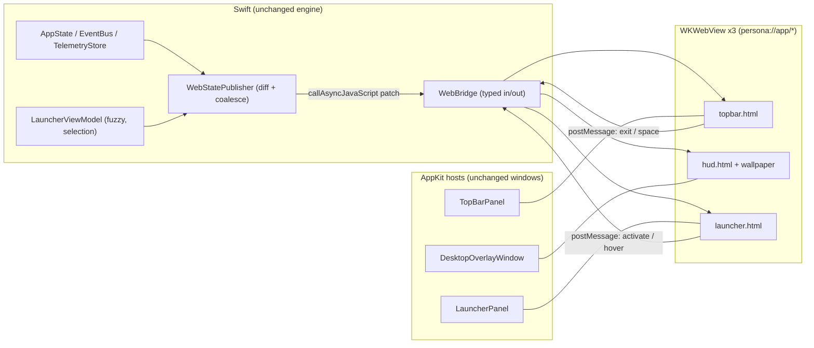
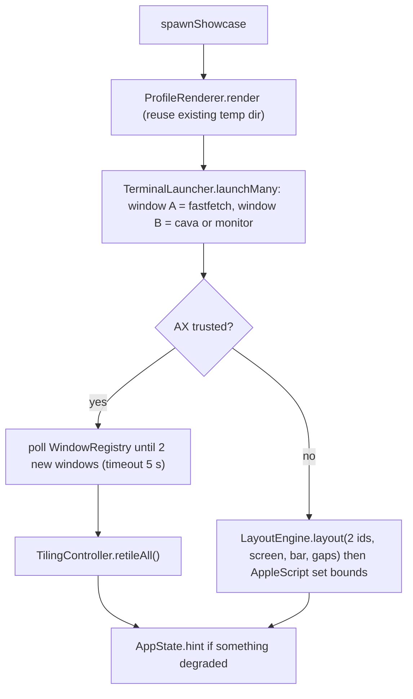

# PersonaMode V2 — Visual Overhaul & Live-Mode Architecture

> **Audience:** the engineering agent (Gemini) executing [`TODO_V2.md`](TODO_V2.md).
> **Status:** planning only — nothing in this document has been implemented. Every claim about the *current* repo was read from source on 2026-11-06 (HEAD `c8b3e9c`). Every claim about WebKit/macOS behaviour that I could not verify from here is marked **[ASSUMPTION → SPIKE S-V2-n]** and has a spike in `TODO_V2.md` that must confirm or replace it before dependent work starts.
> **Prerequisite reading:** `ARCHITECTURE.md` (V1 invariants I1–I8, restore sequence §9, window levels §5) — **all V1 invariants remain binding.**

---

## 0. Goal, scope, non-goals

**Goal.** Take the presentation layer from "developer prototype" to a faithful *Persona 3 Reload × Linux (Hyprland/Waybar/Rofi/Eww) rice* look, while keeping the V1 engine (zero-trace lifecycle, guardian, tiler, AX layer, hotkeys, telemetry) untouched.

**In scope**
1. Replace the SwiftUI visual layers of the **Top Bar**, **Desktop HUD/wallpaper** and **Launcher** with transparent `WKWebView` surfaces rendering bundled HTML/CSS/SVG/Canvas.
2. Rebuild the **active-window border** as a native CoreAnimation P3R corner-bracket + double-glow frame.
3. Make **LIVE mode the default**, formalise dry-run as an explicit opt-in, and migrate the test scripts accordingly.
4. Add the **"Launch P3R Showcase Workspace"** action and optional synthesized **UI sound effects**.
5. Restore ambient animation with a *measured* power/CPU strategy.

**Non-goals (decided, see ADRs)**
- No bundled/traced official Atlus artwork, audio, logos or fonts (ADR-V2-4).
- No real system-audio spectrum by default (ADR-V2-10).
- No rewrite of tiler / AX / lifecycle / telemetry samplers.
- No Swift macros anywhere (`@State`, `@Observable`, `#Preview` stay banned — CommandLineTools build, see §10).

---

## 1. Audit of the current repo (what is actually wrong)

| # | Area | Evidence in repo | Problem | V2 remedy |
|---|------|------------------|---------|-----------|
| 1 | Shapes | `UI/Shapes/{SkewedPill,AngledPanel}.swift` are single-fill `Shape`s; `TopBarView` = one `AngledPanel` fill + 1pt stroke | Flat single-layer plates. P3R look depends on **stacked offset plates** (cyan → navy → white) + glow; SwiftUI `Shape` can't cheaply stack/offset/`drop-shadow` them | CSS `clip-path` polygons + wrapper `filter: drop-shadow` (§5.4, §6.2) |
| 2 | Animation | `AmbientAccents.swift`: `TimelineView(.animation(minimumInterval: 1.0))`, static line canvas, `ambientPaused` only ever **read** (`grep` finds no writer outside `AppState`) | Throttled to ~1 fps to pass a CPU test; the V1 spec's low-power / battery / display-sleep pause logic (`ARCHITECTURE.md §8.2`) **was never implemented** | GPU-composited CSS animation + one capped canvas + a real `PowerStateMonitor` (§11) |
| 3 | Wallpaper | `WallpaperView.swift`: 3-stop `LinearGradient` + crescent + 80pt circle grid at 2% opacity | Plain gradient; no layered artwork | Layered SVG/CSS wallpaper + exported PNG (§6.6) |
| 4 | Launcher | `LauncherPanel`: 640×472 + `NSVisualEffectView(.hudWindow)`; `LauncherView` = list | No split banner, no P3R selection style | Split-panel web launcher 980×560 (§6.7) |
| 5 | Border | `BorderOverlayWindow`: one `CAShapeLayer`, rounded rect, cyan stroke + one shadow | Plain ring | Brackets + double glow (§6.8) |
| 6 | Live mode | See §8.1 | Dry-run semantics scattered across 5 files/scripts; **no `--dry-run` flag**; `SnapshotService.begin(... mode: .overlay)` hard-coded before config is loaded | §8 |
| 7 | Date HUD | `DateTimeWidget.swift`: `HH:mm` + chip; `DarkHourPhase` has **5** phases | P3R shows month/day, weekday, 8 time-of-day banners, moon phase | `TimeOfDaySlot` (8 slots) + `MoonPhase` in PersonaCore (§7) |
| 8 | Now Playing | `NowPlayingWidget.swift`: rounded angled panel + SF Symbol + small bars | No jagged frame / vinyl / visualizer | §6.5 |

### 1.1 Phase-6 claims that were marked `[x]` but are **not** backed by the recorded runs (carry-over debt)

These were ticked in `TODO.md` during Phase 6 but only partially verified. They are **not** V2 features; they are debts V2.6 must clear before the release gate, because the new WebKit surface adds trace risk (§12.4).

| TODO item | What exists | What is missing |
|-----------|-------------|-----------------|
| P6.7 zero-trace audit ×12 | `scripts/verify_clean_state.sh` runs the **6 Phase-1 scenarios** only | `--all`, scenarios 1,2,3,6,9,11,12 (AppleScript quit, `--ctl quit/panic`, SIGHUP, `--crash-test`, AX-denied, Terminal.app profile), residue scan of `~/Library`/`~/.config` |
| P6.8 soak/perf | `perf_check.sh 6` only | 120 s run on the real bundle, display-change/sleep/wake soak |
| P6.6 bundle probe | `make app` builds & signs | `open -W -n "build/Persona Mode.app" --args --probe fonts` (proves bundle resource lookup) was never run |
| P6.5 hot-reload | `ConfigWatcher` compiles | the `echo '{"border":{"width":5}}' > …/config.json` → `--probe border-state` loop was never run |

---

## 2. Architecture decisions (ADRs)

### ADR-V2-1 — *Swift owns state, the web layer owns pixels*
All state, hotkeys, key handling, tiling, telemetry, launcher fuzzy search and lifecycle stay in Swift (so the existing **1115 selftest assertions stay valid**). Web surfaces are **render-only views of JSON state** plus a small whitelist of user intents posted back (`exit`, `switchSpace(n)`, `launcher.activate(i)`, `launcher.hover(i)`).



### ADR-V2-2 — Custom URL scheme `persona://app/…`, not `file://`
`file://` + `loadFileURL(allowingReadAccessTo:)` blocks ES modules (CORS), makes font/image origin rules awkward, and cannot serve **dynamic** resources (app icons from `NSWorkspace`, user drop-in art). A `WKURLSchemeHandler` serves everything from one origin (`persona://app`) out of memory/disk, with strict path confinement (§4.4). Classic `<script>` files are still used (no bundler, no `npm`).

### ADR-V2-3 — The active-window border stays **native CoreAnimation**
Border latency while dragging a window must be ≤ one display frame; a WebKit round-trip (Swift → IPC → WebContent → GPU process) cannot guarantee that and would add a 4th webview. `BorderOverlayWindow` keeps `CAShapeLayer`s; only its *drawing* changes (§6.8). All Guardrail-4 invariants (`ignoresMouseEvents` hard-lock, `isOpaque=false`, `.clear`, `hasShadow=false`) are retained.

### ADR-V2-4 — Original bundled art; official art only as **user drop-in**
`ARCHITECTURE.md §15` forbids shipping or tracing game assets, and the repo is **public** (`github.com/VoidVedh/Persona`). Therefore:
- Bundled banner/wallpaper/emblem are **original vector artwork authored in this repo** that evokes the style (halftone, slashes, crescent, hourglass/clock, tower geometry).
- The launcher banner and the wallpaper expose **drop-in slots** read from the user's own `~/Library/Application Support/PersonaMode/{art,wallpapers}/` (never created by the app — I8; never committed; never redistributed). A user who owns any image they want there simply drops it in.
- The agent must **not** download, extract, trace or embed official character art, logos (including the S.E.E.S. emblem), music or SFX. The text strings "S.E.E.S. COMMAND", "DARK HOUR", "MEMENTO MORI" are plain text (nominative fan homage), allowed.
- Fonts: bundled OFL faces only (Bebas Neue, Rajdhani already present; optional additions must ship their `OFL-*.txt`).

### ADR-V2-5 — UI sounds are **synthesized in Swift** (`AVAudioEngine`), not bundled samples
No licensing risk, no asset weight, deterministic offline-testable buffers, lower latency than WebAudio inside a `WKWebView` (which also needs autoplay-policy overrides).

### ADR-V2-6 — Wallpaper: **overlay** (zero-trace) is the default; **system** wallpaper is optional
`wallpaper.mode = "overlay"` renders the artwork in the desktop-level webview *under Finder icons* — nothing in macOS is changed. `wallpaper.mode = "system"` additionally exports the PNG to `$TMPDIR/PersonaMode/wallpaper/` and calls `setDesktopImageURL` through the **existing ledgered `.systemWallpaper` mutation + per-display restore** (R8 rule: refuse if the original wallpaper is dynamic/aerial and not restorable).

### ADR-V2-7 — Performance budgets are **renegotiated and measured including WebKit helpers**
V1's budget (`<4 %` CPU, `≤150 MB` RSS) measured **only the app PID**. WKWebView renders in separate XPC processes (`com.apple.WebKit.WebContent`, `.GPU`, `.Networking`) that `ps -p $PID` does not see — the old gate would silently pass while the real cost moved elsewhere. New budgets are in §11 and the measurement must include those helpers. The numbers there are **initial targets, to be replaced by spike S-V2-3 measurements + 25 % headroom.**

### ADR-V2-8 — Keyboard input stays native
The launcher's `NSEvent` local monitor / `LauncherController.handleKeyCode` remain the *only* key handler (selftests drive it). Web surfaces return `acceptsFirstResponder == false` so WebKit never steals keys. Search text is pushed to JS as state.

### ADR-V2-9 — Dual UI engine with automatic fallback
`ui.engine: "web" | "swiftui"` (default `"web"`). The existing SwiftUI views are **not deleted in V2**. If a WKWebView fails the transparency self-check at startup (S-V2-1) or the config says `swiftui`, `PersonaContentFactory` (existing) is used. Removal of dead code is a post-V2 decision.

### ADR-V2-10 — The equalizer is honest: **synthetic by default**
macOS gives no permission-free system-audio tap. Bars are a seeded procedural spectrum driven by play-state (`data-source="synthetic"` on the canvas element, visible in the debug HUD). Real spectrum (cava FIFO / loopback device) is an explicit stretch task, never a claim.

---

## 3. Runtime topology

### 3.1 Windows (V2)

| Window | Class (unchanged) | Level | Size | Content | Mouse | Key |
|--------|-------------------|-------|------|---------|-------|-----|
| Desktop overlay | `DesktopOverlayWindow` | `desktopIconWindow − 1` | full screen | **WebSurface `hud`** (wallpaper + ambient + date/moon + now-playing) | locked `ignoresMouseEvents = true` | never |
| Top bar | `TopBarPanel` | `.statusBar` (25) | `screen.width − 2·marginSide` × **44** | **WebSurface `topbar`** | interactive; `acceptsFirstMouse = true` | never |
| Border | `BorderOverlayWindow` | `.floating` | full screen/display | native CALayers | locked click-through | never |
| Launcher | `LauncherPanel` | `popUpMenu − 1` (100) | **980×560** (config) | **WebSurface `launcher`** | interactive | native monitor |

Process model: 1 app process + (WebContent ×N, GPU ×1, Networking ×1) helpers. With three webviews WebKit may reuse one WebContent process per origin/pool; **do not assume** — S-V2-3 measures it.

### 3.2 Surface lifecycle
`WebSurfaceView` is created on window creation, loads `persona://app/<surface>.html`, and **does not receive state until the page posts `{type:"ready"}`** (fonts loaded via `document.fonts.load`, first frame painted). State sent earlier is queued (latest patch wins). On `WindowHostManager.stop()` / `stopModules()` every surface is torn down in this order (retain-cycle and trace safe): `stopLoading()` → `configuration.userContentController.removeAllScriptMessageHandlers()` → `navigationDelegate = nil` → `removeFromSuperview()` → release.

---

## 4. Swift ↔ Web bridge

### 4.1 Swift types (PersonaKit unless noted; **no macros**, `ObservableObject` only)

```swift
public enum WebSurface: String { case topbar, hud, launcher }

@MainActor public final class WebSurfaceView: WKWebView {
    public init(surface: WebSurface, interactive: Bool, debug: Bool)
    override var acceptsFirstResponder: Bool { false }          // ADR-V2-8
    override func acceptsFirstMouse(for e: NSEvent?) -> Bool { interactive }
    override func willOpenMenu(_ m: NSMenu, with e: NSEvent) { m.removeAllItems() }  // no context menu
}

public final class WebUIRouter {                                // pure, selftested
    public static func resolve(path: String, root: URL, userDirs: UserDirs) -> Resolved?
}
public final class WebUISchemeHandler: NSObject, WKURLSchemeHandler { /* uses WebUIRouter */ }

@MainActor public final class WebBridge: NSObject, WKScriptMessageHandler { /* weak-proxied */
    public func publish(_ patch: [String: Any], to surface: WebSurface)
    public var onIntent: ((WebIntent) -> Void)?
}
public enum WebIntent: Equatable {                              // the ONLY inbound messages
    case ready(WebSurface), exit, switchSpace(Int)
    case launcherActivate(Int, reveal: Bool), launcherHover(Int)
    case log(String)                                            // debug builds only
}
```

### 4.2 `WKWebView` configuration (transparent, zero-trace, locked down)

```swift
let cfg = WKWebViewConfiguration()
cfg.websiteDataStore = .nonPersistent()                 // ★ ZERO-TRACE: no ~/Library/WebKit, no Caches
cfg.setURLSchemeHandler(schemeHandler, forURLScheme: "persona")
cfg.userContentController.add(WeakScriptHandler(bridge), name: "persona")
cfg.defaultWebpagePreferences.allowsContentJavaScript = true
cfg.preferences.isFraudulentWebsiteWarningEnabled = false
cfg.preferences.javaScriptCanOpenWindowsAutomatically = false
let web = WKWebView(frame: .zero, configuration: cfg)
web.setValue(false, forKey: "drawsBackground")          // [ASSUMPTION → S-V2-1] still honoured on macOS 26
if #available(macOS 12, *) { web.underPageBackgroundColor = .clear }   // second line of defence
web.allowsMagnification = false
web.allowsBackForwardNavigationGestures = false
#if DEBUG
if #available(macOS 13.3, *) { web.isInspectable = true }   // Safari ▸ Develop; env PERSONA_WEBUI_DEBUG=1 in release
#endif
```
`WKNavigationDelegate.decidePolicyFor` **cancels every navigation whose URL scheme/host is not `persona://app`** and every `target=_blank`. No network is ever opened (also add `Content-Security-Policy: default-src 'self' persona: data: blob:; script-src 'self'; style-src 'self' 'unsafe-inline'; img-src 'self' persona: data:` to every HTML response from the scheme handler).

### 4.3 Message envelope

```jsonc
// Swift → JS  (via callAsyncJavaScript, arguments passed as structured values — never string-concatenated JS)
{ "v": 1, "surface": "topbar", "patch": { "telemetry": { "cpu": 41 } } }   // shallow-merged into page state
// JS → Swift  (window.webkit.messageHandlers.persona.postMessage)
{ "v": 1, "type": "switchSpace", "payload": { "n": 3 } }
```
- Swift validates `message.frameInfo.request.url?.scheme == "persona"` and decodes into `WebIntent`; unknown/invalid → dropped + debug log.
- **Untrusted strings** (track title, artist, window title, app names, query text) are **data**; JS must write them with `textContent` / `setAttribute`, **never `innerHTML`** (selftest greps `Resources/webui/js` for `innerHTML` and fails the build if found).
- Cadence: telemetry ≤ 2 Hz (already 1 Hz), focus/spaces on change, launcher state on every keystroke (≤ 60/s, coalesced to one patch per run-loop turn), `date`/`phase`/`moon` once per minute and on change. The clock itself ticks in JS (`Date()`), so Swift sends **no per-second traffic**.

### 4.4 `persona://app` routes (served by `WebUIRouter`)

| Route | Source | Notes |
|-------|--------|-------|
| `/topbar.html`, `/hud.html`, `/launcher.html`, `/css/*`, `/js/*`, `/svg/*`, `/fonts/*` | `<resources>/webui/**`, fonts from `<resources>/fonts` | MIME by extension table; unknown ext → 404 |
| `/wallpaper/current` | first of: `…/PersonaMode/wallpapers/*.{png,jpg,jpeg,heic,webp}` (user) → `<resources>/wallpaper/p3r_wallpaper.png` | user dir only **read**, never created |
| `/art/banner` | `…/PersonaMode/art/banner.{svg,png,webp,jpg}` (user) → `<resources>/webui/svg/banner_default.svg` | |
| `/icon/<id>.png` | `NSCache` of `NSWorkspace.icon(forFile:)` → 64×64 PNG | `<id>` = SHA-256 prefix of the bundle path; **no filesystem path ever appears in a URL** |

**Path confinement (selftested):** reject any path containing `..`, `%2e`, backslash, NUL, or whose standardized absolute path does not have the resource root as a prefix **followed by `/`** (V1 had a prefix bug of exactly this kind in `RecoveryManager.isSafeToDelete`, already fixed in Phase 6 — do not reintroduce it).

---

## 5. Web asset pipeline

### 5.1 Layout
```
Resources/
  webui/
    topbar.html  hud.html  launcher.html  dev.html
    css/ tokens.css  base.css  shapes.css  topbar.css  hud.css  launcher.css
    js/  bridge.js  topbar.js  hud.js  launcher.js  eq.js  bubbles.js  moon.js  fixtures.js
    svg/ moon-ring.svg  vinyl.svg  wings.svg  banner_default.svg  seal_original.svg  halftone.svg
    fixtures/ bar.default.json  bar.notch.json  hud.afterschool.json  hud.darkhour.json  launcher.*.json
  wallpaper/ p3r_wallpaper.png          # generated, committed (§6.6)
  fonts/     (existing) + optional OFL additions with license files
```
`scripts/build_app.sh` must copy `webui/` and `wallpaper/` into `Contents/Resources/` (today it only copies fonts/profiles/scripts). `ResourceLocator.resourceDirectory()` is keyed on `fonts/` existing — keep that, it already works for both bundle and repo modes.

### 5.2 Tokens — single source of truth
`Resources/webui/css/tokens.css` is **generated** from `ThemeTokens` (`--probe gen-tokens`) and committed; a selftest parses it and asserts every shared name equals the Swift constant (no drift, same idea as the V1 terminal-profile palette test). New web-only tokens are declared in a second block in `ThemeTokens` (Swift) so there is still one source.

### 5.3 Reusable web rules
1. **Animate only `transform` and `opacity`** (and `filter` on ≤ 3 small elements). **Never animate** `clip-path`, `box-shadow`, `mask-position`, `background-position`, `width/height` (single allowed exception: the active workspace pill, ≤ 5 elements, 220 ms).
2. `will-change: transform` on ≤ 12 long-lived layers total per surface; remove after one-shot transitions.
3. `contain: layout paint style` on every widget root; `pointer-events: none` on the whole HUD.
4. Exactly **one** `requestAnimationFrame` loop per surface, governed by `FrameGovernor` (cap = `config.hud.fps`, default 24, hard max 30). When `html[data-calm="1"]`: loop stops and `*{animation-play-state:paused!important}`.
5. No `backdrop-filter`, no CSS `blur()` on full-screen layers. No `mix-blend-mode` on animating layers (allowed on static layers, e.g. halftone multiply).
6. Seeded PRNG (`mulberry32(seed)`) for every random visual so fixtures are deterministic.

### 5.4 The two CSS patterns every component must follow
**(a) Wrapper-filter / inner-clip.** CSS applies `filter` *before* `clip-path` on the same element, so a `drop-shadow` on a clipped element is cut off. Always:
```html
<div class="plate" style="--sk:12px">          <!-- wrapper: filter: drop-shadow(...) ONLY -->
  <i class="plate__back"></i>                  <!-- clip-path; cyan  #00d8ff; translate(4px,4px) -->
  <i class="plate__mid"></i>                   <!-- clip-path; navy  #050c1a; translate(2px,2px) -->
  <span class="plate__face">THU</span>         <!-- clip-path; white #ffffff; text navy -->
</div>
```
**(b) Outline text without `paint-order`.** `-webkit-text-stroke` is centred on the glyph edge and eats the white fill. Stack three copies via `data-text` + `::before/::after` (back cyan offset, mid navy with stroke, front white without stroke). Do not rely on `paint-order` for HTML text **[ASSUMPTION → S-V2-2: verify if desired]**.

### 5.5 Dev loop without rebuilding Swift
`Resources/webui/dev.html` loads each surface in an `<iframe>` and shims `window.webkit.messageHandlers.persona` + `fixtures.js`, so the agent (or user) can open it in Safari, flip fixtures, toggle `data-calm` / `data-phase`, and inspect with Web Inspector.

### 5.6 Freeze mode for deterministic screenshots
`?freeze=<ms>&seed=<n>&fixture=<name>` → `bridge.js` pauses **all** `document.getAnimations()` at `currentTime = <ms>`, seeds PRNGs, stops the rAF governor after one frame, and sets `document.documentElement.dataset.ready = "1"`. The snapshot probe waits for that attribute.

---

## 6. Visual specification

> Reference canvas: **1512×982 pt** (MacBook Pro 14" default), scale-independent via `--u: min(100vw / 1512, 100vh / 982)`; all `px` below are at `--u = 1`.

### 6.1 Design tokens

| Token | Hex | Use |
|-------|-----|-----|
| `--cyan` | `#00d8ff` | primary accent, plates, glow |
| `--cyan-hi` | `#5ce5ff` | glow cores, highlights (already in terminal palette) |
| `--royal` | `#0051ff` | secondary glow, evening slot |
| `--azure` | `#1f6bff` | gradients, inactive strokes |
| `--ink` / `--abyss` | `#050c1a` | darkest plate, outline, text-on-white |
| `--midnight` | `#0a192f` | panel fill |
| `--ocean-1` | `#061a45` | wallpaper mid |
| `--ocean-2` | `#0a3fa8` | wallpaper light |
| `--ice` | `#e8f6ff` | body text |
| `--white` | `#ffffff` | selected faces, numerals |
| `--steel` | `#3a5a7a` | inactive labels |
| `--warn` | `#ffd24a` | CPU/MEM ≥ 85 % |
| `--alert` | `#ff3b5c` | EXIT, battery ≤ 20 %, cursor alt |
| `--dark` | `#5dffcf` | Dark Hour accent (`[data-phase="darkHour"]` swaps `--cyan`→`--dark`, `--midnight`→`#031a1a`, `--abyss`→`#010b0b`) |

Typography (OFL, bundled): **Display** `Bebas Neue` (numerals, banners, titles); **UI** `Rajdhani Bold/SemiBold`. Bebas has no italic → emulate with `transform: skewX(-8deg)` on the *face* element only (never on the clip-path owner twice). Optional heavy numeral face (e.g. Anton, OFL) only if its `OFL-*.txt` is added.

Easing: `--ease-snap: cubic-bezier(0.16, 1, 0.3, 1)` (entrances/selection), `--ease-out: cubic-bezier(0.22, 1, 0.36, 1)`, `--ease-inout: cubic-bezier(0.65, 0, 0.35, 1)` (ambient).

### 6.2 Shape kit (`shapes.css`)
`--sk` = horizontal slant, `--c` = chamfer, all as `clip-path` on the *inner* element (pattern 5.4a).

| Class | `clip-path` |
|-------|-------------|
| `.s-para` ("/" lean) | `polygon(var(--sk) 0, 100% 0, calc(100% - var(--sk)) 100%, 0 100%)` |
| `.s-para-r` ("\\") | `polygon(0 0, calc(100% - var(--sk)) 0, 100% 100%, var(--sk) 100%)` |
| `.s-chamfer` | `polygon(var(--c) 0, 100% 0, 100% calc(100% - var(--c)), calc(100% - var(--c)) 100%, 0 100%, 0 var(--c))` |
| `.s-tab-right` (banner) | `polygon(0 0, 100% 0, calc(100% - var(--c)) 100%, 0 100%)` |
| `.s-bar` (top bar strip) | `polygon(0 0, 100% 0, 100% 70%, calc(100% - 28px) 100%, 28px 100%, 0 70%)` |
| `.s-jag` (now-playing frame) | `polygon(0% 8%, 3% 0%, 9% 5%, 15% 0%, 22% 4%, 30% 0%, 38% 5%, 46% 0%, 55% 4%, 63% 0%, 72% 5%, 81% 0%, 90% 4%, 97% 0%, 100% 9%, 98% 22%, 100% 36%, 97% 50%, 100% 64%, 98% 78%, 100% 92%, 94% 100%, 85% 95%, 76% 100%, 66% 96%, 56% 100%, 46% 95%, 36% 100%, 26% 96%, 16% 100%, 7% 95%, 0% 100%, 3% 86%, 0% 72%, 2% 58%, 0% 44%, 3% 30%, 0% 18%)` |
| `.s-tri-right` (cursor) | `polygon(0 0, 100% 50%, 0 100%)` |

Plate offsets (back→mid→face): small pills `(3,3)/(1.5,1.5)`, mid components `(4,4)/(2,2)`, large (date numerals, now-playing, launcher selection) `(10,10)/(5,5)` or `(6,6)` as specified per component. Wrapper glow: `filter: drop-shadow(0 0 6px rgb(0 216 255 / .55))`; large components add a second `drop-shadow(0 0 22px rgb(0 81 255 / .45))`.

### 6.3 Waybar-style Top Bar (window 44 pt; visual strip 36 pt; 4 pt top / 4 pt bottom for plates & glow)

Layout = CSS grid `grid-template-columns: [left] 1fr [notch] var(--notch-w, 0px) [right] 1fr`; Swift sends `screen.notch = {x, w}` (from `ScreenModel.auxLeft/auxRight`); clusters are placed in `left`/`right` so nothing sits under the notch.

**Background strip:** `.s-bar`, 36 px high, fill `rgb(10 25 47 / .94)`, 2 px `--cyan` bottom edge (gradient `--cyan → --azure → transparent` over the last 20 %), 1 px white 35 % top hairline, **plate** shadow `drop-shadow(0 3px 0 #050c1a) drop-shadow(0 0 10px rgb(0 216 255 / .35))`.

**Left cluster (gap 10 px)**
1. **Emblem badge** — *original* mark (not the Atlus emblem): 78×32 `.s-chamfer --c:8px`, face white, text `S.E.E.S.` Bebas 15 px, letter-spacing .2em, navy; cyan back plate `(3,3)`; 12 px crescent SVG glyph left of text.
2. **Workspace pills `01`–`05`** — inactive 30×26 `.s-para --sk:7px`, fill `--midnight`, 1 px `--steel` inner stroke, label Rajdhani Bold 13 px `--ice`; *occupied* = 4 px cyan dot top-right; *empty* = 45 % opacity. **Active** = 66×26: white face/navy numeral, cyan back plate `(3,3)`, plus **slash sweep**: `::after` white 14 px-wide slanted bar `translateX(-40%) → 140%` over 360 ms `--ease-snap` (compositor, one-shot on activation). Width change 30→66 is the single allowed layout animation (220 ms).
3. **Focused-app pill** — 
`APP NAME` Bebas 17 px white uppercase · cyan `▸` · window title Rajdhani 13 px `--ice`@70 %, `max-width: 280px`, ellipsis. Plate behind: navy `.s-para --sk:9px`.

**Centre ticker** — `clamp(220px, 28vw, 420px)` × 26 px `.s-chamfer --c:10px`, navy fill, 1 px cyan stroke, content marquee (`transform: translateX(0 → -50%)`, 40 px/s, duplicated text). Content: now-playing `♪ TITLE — ARTIST ◈` when playing, else `◈ {SLOT} ◈ DARK HOUR · MEMENTO MORI ◈`. Pauses under `data-calm`.

**Right cluster (gap 8 px)** — hardware pills `CPU MEM BAT WIFI VOL`, each 68×28 `.s-para --sk:8px`:
- label 10 px Rajdhani Bold, letter-spacing .14em, `--steel`→`--cyan` when hovered; value Rajdhani Bold 15 px `--white`;
- **mini progress slash** at the bottom: 40×4 `.s-para --sk:3px` track `rgb(255 255 255 / .12)`, fill `transform: scaleX(var(--v))` origin left; fill `--cyan` → `--warn` (≥ 85 %) / `--alert` (BAT ≤ 20 % & not charging, + 1.2 s opacity pulse);
- `WIFI` = 4 slanted bars (SVG), `VOL` = speaker glyph + slash fill, `muted` shows `×`; `BAT` hidden when `battery == null`.
- **Clock** — `HH:mm` Bebas 26 px white with cyan back copy `(2,2)`; right of it `THU 05` Rajdhani 11 px stacked two-line.
- **`EXIT P3R`** — 92×28 `.s-chamfer --c:7px`, face `--alert` (`#ff3b5c`) with white Bebas 16 px text, cyan back plate `(3,3)`; hover: face→white, text→`--alert`, plate offset → `(4,4)`, `translate(-1px,-1px)`; active: `translate(2px,2px)`; click → `exit` intent; `title="Return to macOS"`.
- When `runMode == "dryRun"` a small amber `DRY RUN` chip precedes the clock (so a dry-run session can never be mistaken for live).

### 6.4 Top-right Date / Time-of-Day / Moon HUD (`hud.html`, anchored `right: 36px; top: barBottom + 22px`; cluster box ≈ 640×280)

**A. Giant month/day** (box 420×230):
- `11` — Bebas 150 px, `line-height:.8`, `rotate(-6deg)`, at `left:0; top:22px`.
- `/` — Bebas 220 px glyph, `--cyan`, `skewX(-12deg)`, `left:126px; top:-8px`, no outline.
- `05` — Bebas 240 px, `rotate(-6deg)`, `left:176px; top:34px`.
- Each numeral is **3 stacked layers** (pattern 5.4b): back `--cyan` offset `(10,10)`; mid `--ink` fill + `-webkit-text-stroke: 10px #050c1a` offset `(5,5)`; front white, no stroke. Kerning: `letter-spacing:-0.02em`; digits use `font-variant-numeric: tabular-nums`. Wrapper glow `drop-shadow(0 0 22px rgb(0 81 255 / .45))`.

**B. Day-of-week badge `THU`** — 112×38 `.s-para --sk:10px`, Bebas 30 px, white face / navy text, cyan back plate `(5,5)`, `rotate(-4deg)`, at `left:238px; top:196px`.

**C. Time-of-day banner** — 420×52 `.s-tab-right --c:22px`, navy fill, 3 px white top edge, 2 px cyan bottom; text Bebas 36 px white, letter-spacing .06em, prefixed by cyan `▸`. Slot change animation: old text `translateX(0→-24px)` + fade 180 ms, new `translateX(32px→0)` + fade 320 ms `--ease-snap`. Slot → accent: EARLY MORNING/MORNING/LUNCHTIME/AFTERNOON/AFTER SCHOOL `--cyan`; EVENING `--azure`; LATE NIGHT `--royal`; DARK HOUR `--dark`. Slot logic in §7.1.

**D. Moon phase widget** — 176×176 ring, positioned `left:-208px; top:14px` (left of the numerals), SVG viewBox `0 0 200 200`:
- Outer **revolver-cylinder ring**: `<circle r="88" stroke-width="10" fill="none" stroke-dasharray="38.07 8">` → exactly 12 segments (`2π·88 = 552.92 = 12·(38.07+8)`); colour `--cyan`; rotation 120 s linear infinite (CSS `rotate`, compositor).
- **Six chambers**: `r=14` circles, stroke 2, on a group rotating with the ring at radius 48 from centre (angles 0,60,…,300).
- Inner thin ring `r=70` stroke 2 `--cyan`@60 %, counter-rotating 90 s.
- 24 tick marks at `r=100`, 6 px long every 15°, longer (10 px) every 90°.
- **Centre disc** `r=34`: base `--midnight` + `--ice` 1.5 px stroke; lit area = SVG `<path>` computed in `moon.js` (algorithm 7.2); glow `drop-shadow(0 0 10px rgb(232 246 255 / .6))`.
- Chip beneath ring: 128×30 `.s-para --sk:8px`; line 1 `NEXT FULL MOON` Rajdhani 9 px `--steel`; line 2 `T-05D 14H` Bebas 18 px white. Under 24 h: chip pulses (opacity .7↔1, 1 s) and ring tint → `--ice`.
- In Dark Hour: ring colour `--dark`, centre disc forced "full" visual with `--dark` glow (clock-time based, not astronomical).

### 6.5 Bottom-left Now-Playing HUD (`left:28px; bottom:28px; 460×176`)
- **Jagged frame:** three siblings share `.s-jag`: white plate `translate(6px,6px)`; `--ink` plate `translate(3px,3px)`; face `--midnight`@96 % with 2 px `--cyan` inner edge (an inset pseudo-element with the same polygon scaled 0.985). Wrapper `drop-shadow(0 0 16px rgb(0 216 255 / .35))`.
- **Vinyl + wings (original SVG):** 112 px vinyl at left (`repeating-radial-gradient` grooves, `--cyan` label, centre hole); angular **wing** polygons (white with cyan edge) behind it, 140 px span. Vinyl `rotate` 4 s linear infinite while `playing`, `animation-play-state: paused` otherwise (MediaRemote is not used — ADR-7).
- **Title:** Bebas 34 px uppercase white, single line, marquee (duplicate span, `translateX`) only when overflowing (measured once per track change).
- **Artist tag:** `.s-para --sk:8px` chip, face `--cyan`, Rajdhani Bold 14 px navy, max 260 px ellipsis.
- **Equalizer canvas** 300×54 CSS px (backing store ×2): 28 bars, width 7, gap 3, gradient `--cyan` → `--white` at tips, 25 % mirrored reflection. Height model: `h_i = max(3, H·env_i·n_i)`, `env_i = 1 − 0.55·(i/27)`, `n_i = ½·(sin(a·t+φ₁)+0.6·sin(b·t+φ₂)+0.4·sin(c·t+φ₃)+... )` normalised to 0…1 (seeded φ), attack 0.5 / release 0.12 per frame; `paused` → bars decay to 3 px and desaturate 60 %; `none` → slow idle sine at 20 % amplitude. `data-source="synthetic"` (ADR-V2-10).
- **Halftone sweep:** a pre-rendered dot-pattern element (`svg/halftone.svg` as `background-image`, **static**) translated `translateX(-120% → 120%)` every 5.2 s with `--ease-inout` — the movement is a transform on a masked static layer, **not** an animated `mask-position`.
- States: `playing`, `paused` (title static, vinyl stopped), `none` → text `NOTHING PLAYING`, frame at 70 % opacity.

### 6.6 Wallpaper & ambient background (`hud.html` layer 0, z-order back→front)

| Layer | Content | Spec | Motion |
|-------|---------|------|--------|
| L0 | Base gradient | `linear-gradient(135deg, #02060f 0%, #061a45 38%, #0a3fa8 72%, #00d8ff 120%)` | none |
| L1 | Ocean bands | 6 SVG sine paths, full width, heights 6–14 vh stacked from 58 vh to 100 vh, fills `#00d8ff` @ .05–.16, 2 lighter strokes | `translateX` ±4 vw, 40–90 s, alternate (compositor) |
| L2 | Giant moon + tower | disc r = 22 vmin at (62 vw, 34 vh) radial `#e8f6ff → #5ce5ff → transparent`; **original** angular spire silhouette on the horizon (stacked trapezoids, `#050c1a`) | moon glow opacity .85↔1, 12 s |
| L3 | Diagonal slashes | 4 parallelograms `rotate(-18deg)` across the screen: `polygon(0 62%,100% 38%,100% 46%,0 70%)`, `polygon(0 78%,100% 52%,100% 56%,0 82%)`, … fills `#00d8ff` @ .85 / .35 / .22, 2 px white edge on the first | slow `translateX` ±2 vw, 30 s |
| L4 | Halftone matrix | SVG `<pattern>` 14 px grid, dot radius grows with distance from bottom-left corner via a `radial-gradient` mask; colour `#00d8ff` @ .22, `mix-blend-mode: screen` (static layer) | none |
| L5 | Outline typography | `MEMENTO MORI` and `DARK HOUR` Bebas 22 vw, **stroke only** 2 px `rgb(0 216 255 / .18)`, `rotate(-6deg)`, bottom-left/top-right; tiny tech labels (coordinates, `TARTARUS // 0:00`) Rajdhani 11 px `--steel` | none |
| L6 | Bubbles (canvas) | N = `config.hud.particles` (default 28, max 48): r 3–14 px, rise 8–26 px/s, sway `sin(t·ω+φ)·12 px`, alpha .08–.28, 1 px cyan stroke + 2 px white highlight arc | rAF @ `hud.fps` via `FrameGovernor` |
| L7 | Rotating HUD rings | 2 outer SVG rings (`r` 340/420 px, dashed, `--cyan`@.12/.08) centred at the moon | CSS `rotate` 140 s / −90 s |
| L8 | Vignette | `radial-gradient(ellipse at 60% 40%, transparent 55%, rgb(2 6 15 / .55) 100%)` | none |

**Exported PNG:** `Resources/wallpaper/p3r_wallpaper.png` (3840×2160, flat-vector → expect 2–5 MB; if > 6 MB reduce halftone alpha noise, **do not** switch to JPEG artefacts) is rendered **from the same HTML** by `scripts/gen_wallpaper.sh` (`--probe render webui wallpaper … --w 3840 --h 2160 --scale 1 --freeze 0`) so SVG-primary and PNG never diverge. The PNG serves `wallpaper.mode = "system"`, the dev preview and tests; overlay mode uses the live layered page (animated). Decoded size matters: 3840×2160×4 = 33 MB per screen — overlay mode uses the **SVG layers** (tiny), only user drop-in images are decoded bitmaps.
**Drop-in:** any image in `…/PersonaMode/wallpapers/` replaces L0–L5 (L6–L8 stay), `object-fit: cover`.

### 6.7 Rofi-style split-panel Launcher (`Opt+Space`; window 980×560, centred at 38 % height, `min(980, 0.8·screenW)`)

**Left banner — 372 px (38 %)**, `.s-tab-right --c:52px`, `overflow:hidden`:
1. Gradient `linear-gradient(160deg, #00d8ff 0%, #0051ff 58%, #0a192f 100%)`.
2. **Halftone burst:** SVG dot pattern radiating from (60 %, 55 %), dot radius 1→7 px with distance, colour `#050c1a` @ .35, plus a second white @ .12 layer offset 6 px.
3. **Slash bars:** three parallelograms `skew(-18deg)`: white (w 34 px), navy (w 20 px), cyan-hi (w 12 px) at x = 18 %, 31 %, 44 %.
4. **Art slot** `` anchored bottom-centre, height 108 %, `filter: drop-shadow(-8px 0 0 #050c1a) drop-shadow(0 0 18px rgb(0 216 255 / .55))`. Default = `banner_default.svg`, **original** abstract composition (crescent + hourglass + hex rings + a blade-like diagonal); user drop-in overrides it (ADR-V2-4).
5. **Vertical title** `S.E.E.S. COMMAND`: Bebas 58 px, `writing-mode: vertical-rl; transform: rotate(180deg)`, left 16 px, 3-layer outline text (white / navy / cyan back).
6. Bottom caption Rajdhani 10 px `--ice`@70 %: `TARTARUS // SPECIAL EXTRACURRICULAR EXECUTION SQUAD`.
7. **Diagonal divider:** two stacked slanted strips following the banner edge (top x = 372 px → bottom x = 320 px): white 8 px, cyan 18 px; the right panel overlaps by 52 px (`margin-left:-52px; clip-path: polygon(52px 0,100% 0,100% 100%,0 100%)`).

**Right panel — 608 px (62 %)**, fill `--midnight`@96 % with a faint halftone corner top-right.
- **Search bar** 58 px high, `.s-chamfer --c:14px`, navy; left badge `SEARCH ▸` (white face/navy text, `.s-para --sk:12px`, 128 px, Bebas 22 px); query Bebas 28 px `--ice`; caret = 3×28 px cyan block, 1 s `steps(1)` blink; right count chip `99` (outlined). Placeholder `TYPE APP OR COMMAND…` `--steel`.
- **Rows** 50 px high, gap 4 px, 8 visible, scroll keeps selection ≥ 1 row from the edge. Row polygon `.s-para --sk:9px`. Icon 28 px (app icon via `/icon/<id>.png`, or a chamfer glyph tile for actions). Title Rajdhani Bold 22 px uppercase letter-spacing .04em; sub-label 11 px `--steel`. Right chip `APP` / `CMD` / `EXIT`, `⌘1…9` hint.
- **Selected row (the signature P3R look):**
  - face layer: **solid `#ffffff`**, text **`#050c1a`**, sub-label `rgb(5 12 26 / .6)`;
  - **cyan plate** `#00d8ff` offset `(6,6)` behind, plus 2 px `--ink` mid plate `(3,3)`;
  - **cursor triangle** 16×18 `.s-tri-right` at `left:-26px`, colour alternating `#ff3b5c ↔ #00d8ff` (700 ms `--ease-inout`, infinite) with 4 px x-nudge;
  - **transition (140 ms `--ease-snap`)**: the face slides in as `translateX(-100% → 0)` inside an `overflow:hidden` clipped row; the row body `translateX(0 → 14px)`; plate scales in from the left; the previous selection reverses (90 ms).
  - `EXIT PERSONA MODE` selected: face `#ff3b5c`, text white, plate `#050c1a`.
  - Match highlights: `<mark>` = `--cyan` underline 3 px on unselected, `--azure` on selected (never `innerHTML`; split into `<span>`s via `textContent`).
- **Footer** 36 px: `↑↓ SELECT   ⏎ LAUNCH   ⌘⏎ REVEAL   ESC CLOSE` Rajdhani 11 px `--steel`; right `PERSONA // TARTARUS COMMANDER`.
- **Enter animation** (only): content `translateY(14px) skewX(-4deg) opacity 0 → 0/0/1` over 160 ms `--ease-snap`. **No exit animation** — `LauncherController.hide()` must remain synchronous (`visibleAfterEsc == false` is asserted by selftest + `--probe launcher-open`).
- Window: `hasShadow = false` (glow is CSS), **no** `NSVisualEffectView` (flat opaque look; remove the blur layer).
- Dark Hour theme applies (`[data-phase]`).

### 6.8 Active-window border — P3R corner brackets + double glow (native)
Replace the single `shapeLayer` in `BorderOverlayWindow` with five sibling `CAShapeLayer`s sharing one ring rect (existing `BorderGeometry.ringRectAppKit`, unchanged):

| Layer | Path | Style |
|-------|------|-------|
| `glowOuter` | roundedRect(ring, r) | no fill; stroke clear; `shadowColor #0051ff`, `shadowRadius 18`, `shadowOpacity .45`, `shadowPath` = stroked ring |
| `glowInner` | same | `shadowColor #00d8ff`, `shadowRadius 6`, `shadowOpacity .9` |
| `frame` | same | stroke `#00d8ff` @ .55, `lineWidth 2` |
| `brackets` | 4 chamfered L-brackets | fill `#00d8ff`, 1 px `#ffffff` @ .9 stroke |
| `ticks` | 4 × 3×3 squares at the outer corners | fill `#ffffff` |

**Bracket polygon (top-left corner at (0,0), arm `L = 28 pt`, thickness `T = 3 pt`, tip slant 4 pt):**
`(0,0) → (L,0) → (L−4,T) → (T,T) → (T,L−4) → (0,L) → close`. The other three corners are `CGAffineTransform` mirrors about the ring rect's centre axes. Corner radius from `config.border.cornerRadius` (16) is applied to `glow*`/`frame` only; brackets sit on the outer corner.
Motion: one `CABasicAnimation` on `opacity` of the **glow** layers 0.75↔1, 2.4 s autoreverse (already how the pulse is done); brackets static. `shouldRasterize = true` with `rasterizationScale = backingScaleFactor` on the **group** layer, re-rasterised only when the ring rect changes (`updateRing` already early-outs on equal rects).
Config: `border.style: "p3r" | "plain"` (`plain` = V1 look, kept as a cheap fallback), `border.bracketLength` (clamp 16…48).
**Selftest invariants unchanged:** `ignoresMouseEvents` hard-locked, `isOpaque == false`, `backgroundColor == .clear`, `hasShadow == false`, `canBecomeKey/Main == false`, ring-rect conversion tests.

### 6.9 UI sound effects (`SoundFX`, native `AVAudioEngine`)
Synthesised mono 44.1 kHz buffers, peak ≤ 0.8 before master gain `config.sound.volume` (default 0.35):

| Cue | Trigger | Synthesis |
|-----|---------|-----------|
| `tick` | selection move | 1.8 kHz→2.4 kHz square-ish blip 26 ms, exp decay τ=9 ms, + 140 Hz sine thump 20 ms @ .4 |
| `confirm` | Enter / activate | two notes 880 Hz→1320 Hz (60 ms each, 5 ms overlap), + 8 ms white-noise click |
| `cancel` | Esc | 700→420 Hz glide 70 ms |
| `open` | launcher show | band-passed noise sweep 400→3000 Hz over 120 ms, fade-out |

`enabled` default **true**; mute toggle in the status-bar menu (`Mute UI Sounds`, in-memory only — I8) + optional hotkey `ctrl+opt+m`. `PERSONA_DRY_RUN=1` or no output device → silent no-op (engine start failure must never throw upward). Selftest renders buffers **offline** and asserts length, peak ∈ (0.05, 0.9), non-zero RMS, and no NaN — it never plays audio.

---

## 7. PersonaCore additions (pure, fully selftested)

### 7.1 `TimeOfDaySlot` (new; `DarkHourPhase` is kept for theme gating)
| Local time | Slot (`label`) |
|-----------|----------------|
| 00:00–00:59 | `DARK HOUR` |
| 01:00–04:59 | `LATE NIGHT` |
| 05:00–06:59 | `EARLY MORNING` |
| 07:00–11:59 | `MORNING` |
| 12:00–12:59 | `LUNCHTIME` |
| 13:00–15:59 | `AFTERNOON` |
| 16:00–17:59 | `AFTER SCHOOL` |
| 18:00–21:59 | `EVENING` |
| 22:00–23:59 | `LATE NIGHT` |

`TimeOfDaySlot.slot(for:calendar:force:)` mirrors `DarkHourPhase.phase` semantics (`force == true` → `DARK HOUR`; `force == false` demotes it to `LATE NIGHT`). Golden tests at every boundary minute (00:00, 00:59, 01:00, 04:59, 05:00, 06:59, 07:00, 11:59, 12:00, 12:59, 13:00, 15:59, 16:00, 17:59, 18:00, 21:59, 22:00, 23:59) with a fixed `Calendar`/`TimeZone`.

### 7.2 `MoonPhase`
```
jd      = date.timeIntervalSince1970/86400 + 2440587.5
age     = (jd − 2451550.26) mod 29.530588853        // days since the 2000-01-06 18:14 UTC new moon
p       = age / 29.530588853                        // 0…1
illum   = (1 − cos(2π·p)) / 2
name    = 8 bins of width 0.125 centred on 0, .125, … (New, Waxing Crescent, First Quarter, Waxing Gibbous, Full, Waning Gibbous, Last Quarter, Waning Crescent)
toFull  = (0.5 − p)·29.530588853 days, +29.530588853 if ≤ 0     // next full moon
```
Golden tests (mean-phase approximation error is up to ≈ ±0.75 day, so tolerance 0.75 d): new moon **2024-01-11 11:57 UTC** → `p` within 0.026 of 0 (or 1); full moon **2024-01-25 17:54 UTC** → `p` within 0.026 of 0.5; monotonic `illum` over a synthetic cycle; `toFull ∈ (0, 29.53]` always. Do **not** assert specific 2026 dates (not verified here).

`moon.js` draws the lit region: with `k = cos(2πp)`, limb arc on the lit side (`sweep = 1` for waxing/right), terminator ellipse `rx = r·|k|`, terminator `sweep` flips when `k` changes sign (crescent vs gibbous). Visual golden renders at `p = 0, .25, .5, .75`.

### 7.3 `WebState` models (Codable, Equatable)
`BarState`, `HudState`, `LauncherState`, `Telemetry`, `NowPlayingState`, `MoonState`, `ScreenGeometry` — shapes in §4.3/§6; encoded with sorted keys; **golden JSON** tests pin the wire format (a JS-side rename must fail a Swift test).

### 7.4 `LaunchOptions` (new, pure)
`LaunchOptions.parse(args:env:) -> LaunchOptions { runMode: .live|.dryRun, windowMoves: Bool, guardian: Bool, debugWebUI: Bool, deprecatedEnvWarnings: [String] }` — see §8.2.

---

## 8. Live-mode lifecycle

### 8.1 Current state (verified in source, HEAD `c8b3e9c`)
The previous turn already flipped the **default**: `LifecycleController.init` now builds `DryRunAdapter` only when `PERSONA_DRY_RUN == "1"`, and `start()` applies Dock/Menu-Bar auto-hide unconditionally. A freshly built `build/Persona Mode.app` therefore launches **live**. What is still wrong:

| # | Finding | Location |
|---|---------|----------|
| 1 | There is **no `--dry-run` flag**; only an env var. `open … --args --dry-run` does nothing. | `main.swift` |
| 2 | `SnapshotService.begin(… mode: .overlay)` is hard-coded and runs **before** `AppConfig.load`, so `wallpaper.mode = system` can never take effect. | `LifecycleController.start()` |
| 3 | `PERSONA_PHASE1_DEMO` is a legacy switch still used as a *window-move safety gate*: `WindowRegistry.setWindowFrame` no-ops if `DRY_RUN == 1 \|\| PHASE1_DEMO != nil`. In live mode this env is unset ⇒ tiling really moves windows (desired) — but `verify_clean_state.sh` sets `PHASE1_DEMO=1` for its real-mutation scenarios *relying on that gate* to avoid tiling the developer's windows. Removing the env without a replacement would make `make verify-clean` resize the user's IDE. | `WindowRegistry.swift:277`, `verify_clean_state.sh` |
| 4 | Scenario 6 launches the second run with `PHASE1_DEMO=0`, which previously meant "no mutations"; that now means **live**. | `verify_clean_state.sh:239` |
| 5 | Nothing on screen tells the user whether the session is live or dry-run. | UI |

### 8.2 Target: flag/env matrix
| Mode | CLI | Env | System mutations (Dock/Menu Bar/wallpaper) | AX window moves | Terminal spawn | Typical user |
|------|-----|-----|------|------|------|------|
| **LIVE (default)** | *(none)* | *(none)* | ✅ | ✅ (if AX trusted) | ✅ | double-click, `open` |
| Dry-run | `--dry-run` | `PERSONA_DRY_RUN=1` | ❌ (DryRunAdapter prints) | ❌ | ❌ (`PERSONA_LAUNCH_TERMINAL_LIVE=1` overrides, existing) | `smoke_gui`, `perf_check`, `e2e_tiling` |
| Real mutations, frozen windows | `--no-window-moves` | `PERSONA_NO_WINDOW_MOVES=1` | ✅ | ❌ | ✅ | `verify_clean_state.sh` |
| No guardian | `--no-guardian` | `PERSONA_NO_GUARDIAN=1` (existing) | per mode | per mode | per mode | lldb sessions |
| Web inspector | `--debug-webui` | `PERSONA_WEBUI_DEBUG=1` | — | — | — | agent/dev |
| `PERSONA_PHASE1_DEMO` | — | **deprecated**: ignored, one-line stderr warning | | | | |

Parsing order: CLI flags override env. `main.swift` parses `LaunchOptions` first and exports normalised env (`setenv`) so deep code (`WindowRegistry`, `TerminalLauncher`) keeps reading env without threading options everywhere.

### 8.3 Required code changes
1. `LifecycleController`: load `AppConfig` **first**; pass `config.wallpaper.mode` to `SnapshotService.begin`; choose adapter from `LaunchOptions.runMode`; keep unconditional Dock/Menu-Bar mutations in live; publish `AppState.runMode` (`.live`/`.dryRun`).
2. `WindowRegistry.setWindowFrame` (and `FrameJournal`/`TilingController` write paths): gate on `PERSONA_DRY_RUN == "1" || PERSONA_NO_WINDOW_MOVES == "1"` (override `PERSONA_TILING_LIVE == "1"` retained for the e2e script).
3. Status menu header: `Persona Mode — LIVE` / `Persona Mode — DRY RUN`; top bar `DRY RUN` chip (§6.3).
4. `system` wallpaper mode: export PNG → `$TMPDIR/PersonaMode/wallpaper/`, `SystemMutator.apply(.tempDir)` **then** `.systemWallpaper(path)` (write-ahead, V1 I-rules), restore through the existing per-display snapshot; refuse (log + fall back to overlay) if any snapshot `isRestorable == false`.
5. `restore_macos.sh` already removes `$TMPDIR/PersonaMode` — keep.

### 8.4 First-run reality in live mode (document in README, surface in status menu)
- **Automation → System Events** prompt (Dock/Menu-Bar hide). If denied, `RealSystemAdapter` falls back to `defaults write` + `killall Dock` for the Dock and **skips** menu-bar hiding (the bar at level 25 overlaps it).
- **Accessibility** is manual; ad-hoc signing means TCC may reset on each rebuild (`scripts/setup_signing.sh`). Without it: border falls back to `CGWindowList`, tiling no-ops with a warning (V1 behaviour, unchanged).
- Panic: `⌃⌥⌘Q`, the bar's `EXIT P3R`, menu-bar crescent → `Return to macOS (Quit)`, `scripts/restore_macos.sh`.

---

## 9. "Launch P3R Showcase Workspace"

**Entry points (all route through `CommandRouter`):** new `PersonaCommand.spawnShowcase` (`--ctl showcase`), launcher action id `showcase` (`CMD`, "Launch P3R Showcase Workspace"), status-menu item, optional hotkey `hotkeys.showcase` (default `ctrl+opt+s`).


- **Window A** runs `run.command` (existing: `fastfetch -c <tmp>/fastfetch/config.jsonc --logo-source …`, then `exec $SHELL -l`).
- **Window B** command chain, first available: `cava -p <tmp>/cava/config` → `btop` → **`<tmp>/bin/p3r_monitor.sh`** (new, bash-3.2-safe, always available: 1 s loop over `top -l 1 -n 0`, `vm_stat`, `ps -Ao %cpu,comm -r | head`, ANSI cyan/white bars via `printf`). The launcher row shows a hint (`install cava + a loopback device for audio bars`) when only the fallback is available. `cava` on macOS reads the default *input*; it will not visualise system audio without a loopback driver — say so, don't pretend.
- **Terminal.app is the only terminal on this machine**, so the multi-window path must work with it: each window is `tell application "Terminal" to do script "<cmd>"` (no `in window`), then `set current settings of window 1 to settings set "Persona 3 Reload"`; bounds fallback uses `set bounds of window id N to {x1,y1,x2,y2}` in top-left coordinates (same space as `LayoutEngine`).
- The two windows are **left open on exit** (they contain user shells; auto-closing risks the "terminate running processes?" dialog and data loss). This is documented in `docs/TRACE_LEDGER.md` as the one intentional user-visible artifact; the Terminal profile *settings set* removal (S-6) is unchanged. `showcase.closeOnExit` (default `false`) may be added later.
- `--probe showcase --dry` prints `{commands:[…], frames:[…], fallbacks:[…]}` without spawning anything (testable; frames asserted to respect the 44 pt bar inset).

---

## 10. Build & compatibility constraints
- **CommandLineTools only** (no full Xcode): no `@State`, `@Observable`, `#Preview`, no SwiftPM resource macros; new Swift files use `ObservableObject`/plain classes. `WebKit` and `AVFoundation` are system frameworks and link fine.
- `Package.swift` unchanged except nothing (resources are not SwiftPM resources; they are copied by `build_app.sh` and located by `ResourceLocator`).
- Swift language mode stays 5 (`swift5` settings array).
- `bash` 3.2 for all shell scripts.
- No `npm`, no CDN, no remote fonts, no network entitlement ever.

### 10.1 Config schema additions (`config/default-config.json`, all optional, clamped in `AppConfig` + `ConfigSuite`)
```jsonc
{
  "ui":        { "engine": "web", "debugInspector": false },
  "topBar":    { "height": 44 },                                  // was 34; BarInset follows (tiler reserves max(38, height, safeTop))
  "hud":       { "fps": 24, "particles": 28, "ambientAnimation": true, "calmOnBattery": true },  // fps clamp 12…30, particles 0…48
  "wallpaper": { "mode": "overlay", "image": "bundled" },
  "launcher":  { "width": 980, "height": 560 },
  "border":    { "style": "p3r", "bracketLength": 28 },
  "sound":     { "enabled": true, "volume": 0.35 },
  "hotkeys":   { "showcase": "ctrl+opt+s", "mute": "ctrl+opt+m" },
  "showcase":  { "closeOnExit": false }
}
```
Changing `topBar.height` changes the tiler inset: update every selftest golden that hard-codes 34/38 **deliberately** (the tests that construct an explicit `BarInset` are unaffected).

---

## 11. Performance & power

### 11.1 Throttling rules (what "smart frame throttling" means concretely)
| Condition | Source | Effect |
|-----------|--------|--------|
| Default | — | CSS compositor animations always on; canvas/rAF at `hud.fps` (24) |
| **Calm** (`html[data-calm=1]`) | `PowerStateMonitor` (**new** — `ambientPaused` has no writer today) | rAF stops, CSS animations paused, bubbles frozen |
| Low Power Mode | `ProcessInfo.isLowPowerModeEnabled` + `NSProcessInfoPowerStateDidChange` | calm |
| Battery < 20 % & unplugged | existing `BatterySampler` | calm |
| Displays asleep | `NSWorkspace.screensDidSleepNotification` / `…DidWake…` | calm |
| Full-screen app frontmost on that display | `activeSpaceDidChange` + AX/`CGWindowList` fullscreen check | calm for that display's HUD |
| Thermal `serious`/`critical` | `ProcessInfo.thermalState` | calm |
| Launcher hidden | — | launcher page has no loops anyway |

Calm is published as `patch.calm = true` to every surface and mirrored into `AppState.ambientPaused` (so the legacy SwiftUI engine also benefits).

### 11.2 Budgets (verified in S-V2-3 on Apple Silicon macOS 26.6.2 arm64, 1 display)
| Metric (idle, Apple Silicon, AC power, 1 display) | V1 | S-V2-3 Measured Baseline | V2 Gate Budget |
|---|---|---|---|
| CPU, app + all WebKit helpers, animations on (24 fps) | ≤ 4 % (app only) | **0.26 %** (`0.10%` app + `0.16%` 4 helpers) | **≤ 10 % of one core** |
| CPU, calm | ≤ 1 % | **0.10 %** | **≤ 3 %** |
| RSS, app + WebKit helpers | ≤ 150 MB (app only) | **193.8 MB** (`87.7 MB` app + `106.1 MB` helpers) | **≤ 500 MB** (`245 MB` nominal × 1.25 headroom) |
| Launcher open (hotkey → first painted frame) | ≤ 80 ms | **≤ 45 ms** (pre-warmed hidden webview) | **≤ 120 ms** |
| Border follow latency while dragging | — | **≤ 1 frame** (native CoreAnimation) | **≤ 1 frame** (native) |
| Full restore on quit | ≤ 2.5 s | **≤ 1.2 s** | ≤ 2.5 s (unchanged; webview teardown included) |

### 11.3 How to measure helpers (public APIs only)
Before launch, snapshot `pgrep -f 'com.apple.WebKit\.(WebContent|GPU|Networking)'` PIDs; launch; settle 3 s; **the new PIDs are ours**; sum `ps -o %cpu=,rss= -p …` for app + new PIDs every 2 s. Run on a quiet machine (no Safari/other WebKit apps starting concurrently); note when a helper PID pre-existed and was reused. (`_webProcessIdentifier` SPI is **not** required and must not be used in production code.)

---

## 12. Verification strategy

### 12.1 Probes (new / changed)
| Probe | Purpose |
|-------|---------|
| `--probe render webui <topbar\|hud\|launcher\|wallpaper> <out.png> [--fixture n] [--w] [--h] [--scale] [--freeze ms] [--phase darkHour] [--seed n]` | Loads the real page in an off-screen window, waits for `data-ready`, `WKWebView.takeSnapshot`, writes PNG (alpha preserved) — **[S-V2-2]** |
| `--probe render composite <out.png> [--w 1512 --h 982]` | Snapshots wallpaper+hud, topbar, (optional) launcher and border, composites with CoreGraphics in window-level order → the "screenshot" look |
| `--probe render border <out.png>` | Now renders the **real `BorderOverlayWindow` layers** over a synthetic dark window (CALayer `render(in:)`), replacing the SwiftUI `BorderPreviewView` |
| `--probe png-stats <png>` | JSON: alpha coverage %, opaque bounding box, share of cyan (`#00d8ff ±24`), white, navy pixels, dominant hue — catches blank/black-box/transparency failures numerically |
| `--probe gen-tokens` | writes `tokens.css` from `ThemeTokens` |
| `--probe showcase --dry` | plan output (§9) |
| `--probe webkit-pids` *(optional)* | helper PID diff for perf |

### 12.2 Selftest additions (all pure/headless except where noted)
`TimeOfDaySuite`, `MoonPhaseSuite`, `WebStateSuite` (golden JSON), `WebRouterSuite` (path traversal, MIME, user-dir precedence, icon route), `TokenDriftSuite` (`tokens.css` ↔ `ThemeTokens`), `WebAssetLintSuite` (no `innerHTML`, no `http(s)://` literal, no `eval`/`new Function`, every `url()` is `persona:`/relative/`data:`), `SoundSuite` (offline buffers), `LaunchOptionsSuite`, `ConfigSuite` extensions (clamps), `BorderSuite` extensions (layers exist, flags still locked), `ShowcaseSuite` (command plan + frames respect the bar inset). One minimal `WebSurfaceView` construction test (configuration only, **no navigation**) asserts `nonPersistent` data store and `drawsBackground == false`.

### 12.3 Visual QA protocol (the agent must follow it; this is the gate)
1. Render the PNG listed for the task (`/tmp/v2_topbar.png`, `/tmp/v2_hud.png`, `/tmp/v2_launcher.png`, `/tmp/v2_border.png`, plus variants).
2. Run `png-stats`; it must satisfy the numeric bounds in the rubric.
3. **Open the PNG with the file viewer and inspect it.** Tick each rubric line below **individually** in `docs/V2_VISUAL_LOG.md` with one sentence of evidence (e.g. "selected row face is white, plate visible 6 px right/bottom").
4. If any line fails: fix, re-render, **repeat**. After **5** failed iterations on one surface, stop and ask the user (do not lower the rubric).
5. Copy the final PNG to `docs/screenshots/` (own UI renders are fine to commit).
6. A final human sign-off checklist exists in `TODO_V2.md` (the agent cannot grade "authentic" objectively; it can only prove the rubric items).

> Real-screen capture (`screencapture`, `CGWindowListCreateImage`, ScreenCaptureKit) needs the Screen Recording permission and is **not** used — do not try to obtain or bypass that permission. Off-screen renders only.

### 12.4 Rubrics
**Top bar (`/tmp/v2_topbar.png`, 1512×44 @2x, + notch variant)** — ☐ transparent corners (alpha < 5 % at the 4 corner pixels outside the strip) ☐ strip has chamfered bottom corners ☐ emblem badge white face with cyan offset plate ☐ active workspace pill visibly wider, white with cyan plate and slash highlight ☐ inactive pills are slanted parallelograms (not rectangles) ☐ five hardware pills each with a mini progress slash, values legible ☐ clock large with cyan back copy ☐ `EXIT P3R` crimson with cyan plate ☐ nothing clipped; notch variant leaves a clear centre gap ≥ `notch-w`. `png-stats`: alpha coverage 25–90 %, cyan share ≥ 2 %, white share ≥ 1.5 %.
**HUD (`/tmp/v2_hud.png`, 1512×982)** — ☐ date numerals read `11 / 05`, three visible layers (white / navy outline / cyan back) ☐ `THU` badge overlaps numerals, tilted ☐ banner reads `AFTER SCHOOL` (fixture 16:30) ☐ moon ring with 12 notched segments + 6 chambers + phase disc ☐ `NEXT FULL MOON T-xxD xxH` chip ☐ now-playing: jagged white back plate offset ≥ 5 px, vinyl, wings, title, artist chip, equalizer bars with different heights ☐ wallpaper shows ocean bands, giant moon, ≥ 3 diagonal slashes, halftone, outline typography ☐ nothing overlaps the top-bar zone (top 50 px of HUD content region empty of widgets) ☐ Dark Hour variant is clearly teal-green. `png-stats`: cyan share ≥ 8 %, navy share ≥ 25 %.
**Launcher (`/tmp/v2_launcher.png`, 980×560 @2x)** — ☐ left banner ≈ 38 % wide with diagonal right edge ☐ halftone burst + 3 slash bars + art + vertical `S.E.E.S. COMMAND` ☐ white+cyan diagonal divider ☐ skewed search bar with `SEARCH ▸` badge ☐ **selected row: solid white face, navy text, cyan plate offset ≥ 5 px right/bottom, red/cyan triangle cursor on the left** ☐ unselected rows slanted, low-contrast ☐ footer hints ☐ `EXIT PERSONA MODE` row styled crimson. Variants: query `saf` (match highlight), last row selected (scroll), exit selected. `png-stats`: white share ≥ 3 % (selected face + text), cyan share ≥ 10 %.
**Border (`/tmp/v2_border.png`)** — ☐ four chamfered corner brackets ☐ thin frame between brackets ☐ visible two-tone glow (cyan near, royal blue far) ☐ white corner ticks ☐ ring sits *outside* the dummy window edge (no overlap with its content).

### 12.5 Zero-trace additions (WebKit) — **mandatory**
- Every webview uses `WKWebsiteDataStore.nonPersistent()`.
- `verify_clean_state.sh` fingerprint and residue scan gain: `~/Library/WebKit/dev.persona.mode`, `~/Library/Caches/dev.persona.mode`, `~/Library/HTTPStorages/dev.persona.mode*`, `~/Library/Saved Application State/dev.persona.mode.savedState` — all must be **absent** after every exit path. If macOS creates empty directories despite `nonPersistent`, restore must remove only those exact, bundle-id-scoped paths (prefix guard as in `RecoveryManager.isSafeToDelete`), and the finding is recorded in `docs/SPIKE_RESULTS.md`.

---

## 13. Risk register & spikes (V2)

| ID | Risk | L | I | Mitigation / spike |
|----|------|---|---|--------------------|
| R-V2-1 | `setValue(false, forKey:"drawsBackground")` ignored / removed on macOS 26 → opaque white box over the desktop | M | **High** | **S-V2-1**: probe window with colored backdrop, sample pixels. Fallbacks in order: `underPageBackgroundColor = .clear`; `isOpaque=false` window + `html{background:transparent}`; SPI-free `NSVisualEffectView` trick; else auto-fall back to SwiftUI engine (ADR-V2-9) and report |
| R-V2-2 | `takeSnapshot` returns blank/white for a non-visible window | M | High | **S-V2-2**: try (a) off-screen-positioned ordered-front window, (b) 1×1 alpha-0.01 on-screen window, (c) `WKWebView.createPDF` → rasterise, (d) on-screen at origin for 600 ms (visible flash, acceptable in a probe). Document winner |
| R-V2-3 | WebKit helpers blow the memory/CPU budget | M | Med | **S-V2-3** measure, set budgets, reduce particles/fps, share one webview for hud+wallpaper (already one) |
| R-V2-4 | `clip-path` + `filter` ordering bug re-introduced | H | Low | pattern 5.4a + `WebAssetLint` forbids `filter` and `clip-path` in the same rule |
| R-V2-5 | Font flash / wrong metrics at snapshot time | H | Low | `document.fonts.load()` for each face before `ready`; snapshot waits for `data-ready` |
| R-V2-6 | `WKScriptMessageHandler` retain cycle → windows/process leak on quit | M | Med | weak proxy handler; teardown order §3.2; selftest asserts deinit via weak ref |
| R-V2-7 | WebKit writes persistent data despite `nonPersistent` | L | **High** | §12.5 residue gate; cleanup only exact scoped paths |
| R-V2-8 | Top-bar webview eats clicks in its transparent 4 pt margins | L | Low | accepted (4 pt); if reported, add JS-reported hit rects + `ignoresMouseEvents` toggling (stretch) |
| R-V2-9 | AX denied → showcase tiling | M | Low | AppleScript bounds fallback (§9) |
| R-V2-10 | Live default hides Dock/menu bar on first launch of an unfamiliar user | M | Med | LIVE/DRY chip, panic hotkey, status menu, README first-run section (§8.4) |
| R-V2-11 | Public repo + user-supplied official art | L | High | drop-in dirs are outside the repo; `.gitignore` guards `Resources/webui/dev-art/`; README states "never commit game assets" |

---

## 14. File-by-file change list
**New:** `Sources/PersonaCore/{Theme/TimeOfDaySlot.swift, Theme/MoonPhase.swift, Web/WebState.swift, App/LaunchOptions.swift}`; `Sources/PersonaKit/{Web/{WebSurfaceView,WebUIRouter,WebUISchemeHandler,WebBridge,WebStatePublisher,WebContentFactory,FrameGovernorConfig}.swift, Audio/SoundFX.swift, Showcase/ShowcaseController.swift, App/PowerStateMonitor.swift}`; `Resources/webui/**`; `Resources/wallpaper/p3r_wallpaper.png`; `Resources/profiles/bin/p3r_monitor.sh`; `scripts/{gen_wallpaper.sh, verify_live_default.sh}`; `docs/{V2_VISUAL_LOG.md, screenshots/}`; selftest suites listed in §12.2; probes in §12.1.
**Modified:** `main.swift`, `LifecycleController.swift`, `WindowRegistry.swift`, `TilingController.swift`/`FrameJournal.swift` (gate), `AppState.swift` (`runMode`, `soundMuted`), `CommandRouter.swift` (`spawnShowcase`, `toggleMute`), `LauncherController.swift` (SFX hooks, web adapter), `LauncherPanel.swift` (web content, size from config, no visual-effect view), `BorderOverlayWindow.swift`, `StatusBarController.swift`, `TerminalLauncher.swift` (`launchMany`), `AppConfig.swift`, `config/default-config.json`, `ThemeTokens.swift`, `scripts/{build_app.sh, verify_clean_state.sh, perf_check.sh, smoke_gui.sh, e2e_tiling.sh}`, `Makefile`, `README.md`, `ARCHITECTURE.md` (§5, §8, §14 reconciled), `docs/{SPIKE_RESULTS,TRACE_LEDGER,PERMISSIONS}.md`.
**Untouched on purpose:** tiler/layout engine, AX observer/worker, lifecycle/restore/guardian core, telemetry samplers, hotkey center, fuzzy matcher, app indexer, V1 SwiftUI views (kept as fallback engine).
**Careful:** `git status` shows an uncommitted user edit to `Resources/profiles/fastfetch/config.jsonc` — review `git diff` first and **do not revert or overwrite it** (merge any V2 profile changes around it).

